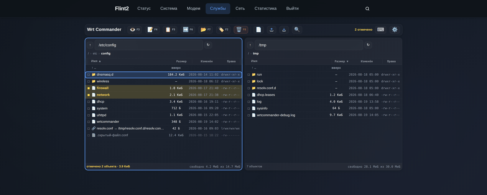
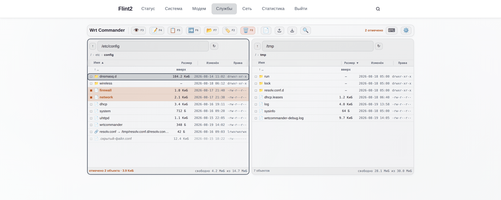
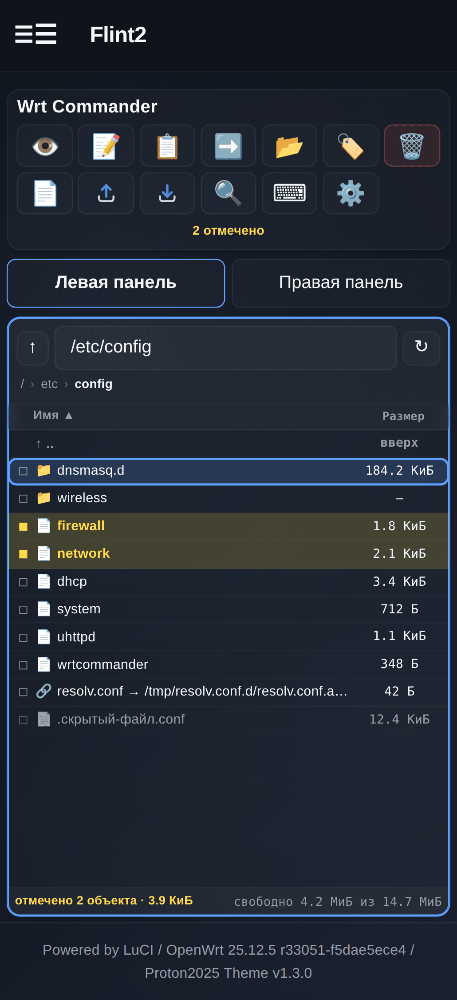
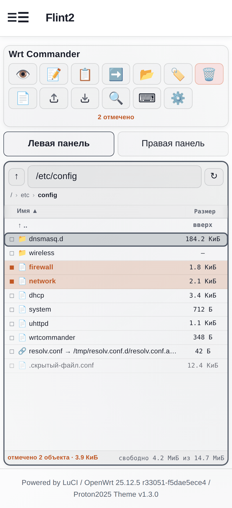
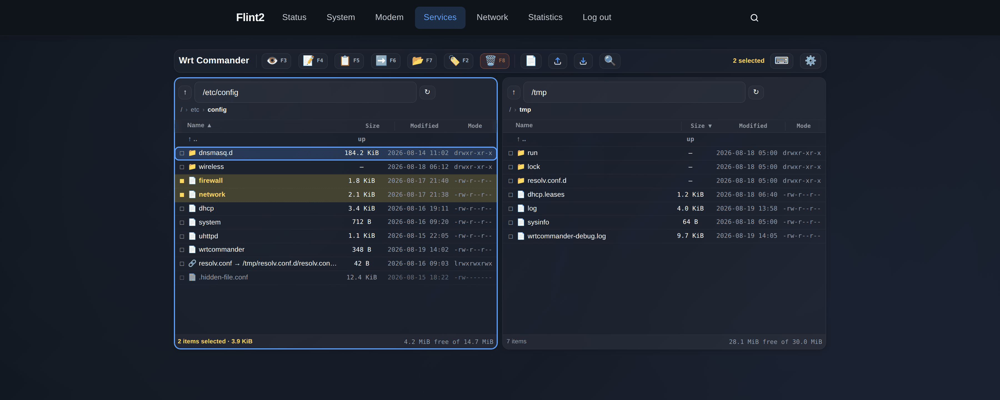
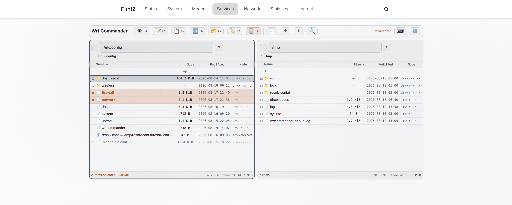
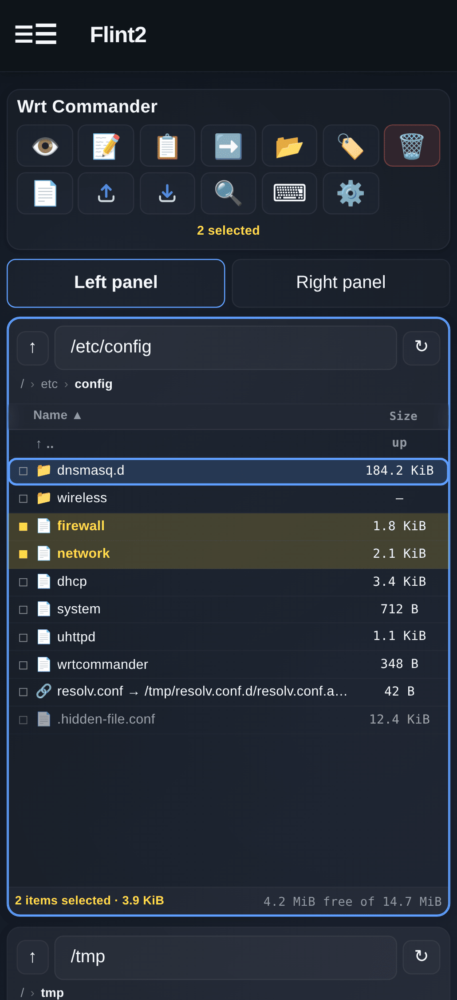
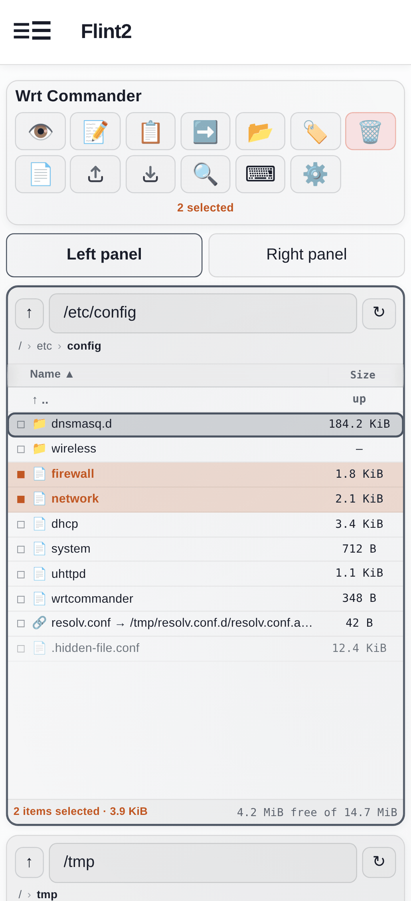

# Wrt Commander

**Русский** · [English](#wrt-commander-english) · [简体中文](#wrt-commander-简体中文)

**Wrt Commander** — двухпанельный файловый менеджер для LuCI на OpenWrt,
рассчитанный на того, кто администрирует роутер. Раскладка та, которую
сделали стандартом Norton, Midnight и Total Commander: две независимые
панели каталогов рядом, одна из них активная, и любая операция по
умолчанию идёт «из активной панели в противоположную». Полный набор
файловых операций, управление и с клавиатуры, и мышью, английский,
русский и упрощённый китайский интерфейс, тёмная и светлая темы, работа как с компьютера,
так и с телефона.





<p align="center">
  
  
</p>

- Две панели с независимыми путём, сортировкой и выделением; **Tab**
  переключает, активная обведена рамкой
- **F5 Копировать / F6 Переместить по умолчанию целятся в каталог
  соседней панели** — ради этого две панели и нужны
- Полное управление с клавиатуры: стрелки, PageUp/Down, Home/End, Enter
  для открытия, Backspace на уровень выше, Insert/Space для отметки,
  Ctrl+A, Ctrl+R
- Каждое действие продублировано иконкой в шапке, так что клавиатура
  не обязательна
- Папка или файл открывается одним щелчком или касанием; двойной
  щелчок возвращается одной галочкой в настройках
- Строка состояния у каждой панели: число объектов, размер выделенного,
  свободное место на этой файловой системе
- Создание / переименование / удаление / копирование / перемещение,
  одного объекта или сразу многих
- Потоковая загрузка и скачивание по HTTP (никогда не base64 через JSON)
- Загрузка папки целиком, со всей вложенностью: выбором каталога на
  компьютере или ZIP-архивом — с телефона тоже
- Просмотрщик и редактор текста с атомарным сохранением и обнаружением
  конфликта
- Правка прав доступа (chmod) и владельца/группы (chown)
- Поиск по имени файла, в текущем каталоге или рекурсивно, с лимитами
- **Английский, русский и упрощённый китайский** через штатный конвейер gettext/`.lmo` LuCI
- Единственный обязательный слой проверки путей, общий для всех
  операций, написанный так, чтобы устоять против `../`, кодированного
  обхода и побега через симлинк (см. **Модель безопасности**)

На телефоне две панели не помещаются, поэтому ниже 900px приложение
показывает по одной панели с переключателем. Сама *модель* панелей не
меняется, поэтому «скопировать в соседнюю панель» означает ровно то же,
что и на десктопе.

## Требования

- OpenWrt 25.12.x (должно работать и на 23.05/24.10 — использованные
  здесь API ubus/rpcd/ucode стабильны на всех этих выпусках)
- LuCI (представления на JS, то есть любой современный LuCI)
- `rpcd` с `rpcd-mod-ucode` (даёт загрузчик плагинов
  `/usr/share/rpcd/ucode`)
- `ucode` и его модули `ucode-mod-fs`, `ucode-mod-uci`, `ucode-mod-math`
- `uhttpd`
- `luci-lua-runtime` — нужен **только** для загрузки/скачивания
  (см. ниже); всё остальное (просмотр, правка, удаление, копирование,
  перемещение, права, поиск) работает без него

Почти всё перечисленное уже стоит на любом роутере со стоковым LuCI —
`luci-base` сам тянет `rpcd-mod-ucode`, `ucode`, `ucode-mod-fs` и
`ucode-mod-uci`. Исключение — `ucode-mod-math`: его не тянет ничто из
LuCI. Установщик ставит недостающее сам, см. «Какие зависимости
ставятся».

## Архитектура

```
Представление LuCI JS (www/luci-static/resources/view/wrtcommander.js)
        |
        |-- ubus/rpcd  ------------------->  usr/share/rpcd/ucode/wrtcommander.uc
        |     (list, stat, read, write,        ubus-объект "luci.wrtcommander"
        |      mkdir, create, rename,           - каждый метод проходит через
        |      remove, copy, move, chmod,         canon() прежде, чем тронуть
        |      chown, search, disk_info,          файловую систему (см. ниже)
        |      dirsize)
        |
        `-- обычный HTTP  ---------------->  usr/lib/lua/luci/controller/wrtcommander.lua
              (GET .../download?path=...        только потоковая передача -
               POST .../upload?dest=...)         сколь угодно большие файлы
                                                  никогда не идут через JSON/ubus
```

Всё, что разумно провести через ubus, через него и идёт. Загрузка и
скачивание — намеренное исключение: у JSON-RPC нет потоковой передачи и
есть практический потолок размера сообщения, поэтому эти две операции
работают по обычному HTTP через небольшой Lua-контроллер. Контроллер
повторяет тот же канонический конвейер проверки пути, что и ucode-бэкенд
(`canon_path()` в Lua-файле повторяет `canon()` в ucode-файле) — почему
эта логика существует в двух экземплярах и что из этого следует для
будущих правок, см. в **Известных ограничениях**.

У `luci.http` есть ловушка, стоившая двух багов. Обработчик файла
вызывается двумя разными способами: если он установлен **до** разбора
тела — идёт потоковая передача и `meta` приходит один раз в начале части;
если тело уже разобрано — LuCI проигрывает буферизованную загрузку и
передаёт `meta` **с каждым куском** (`luci-base/ucode/http.uc`,
`setfilehandler()`). Контроллер читал `dest` обычным `formvalue()` до
установки обработчика, чем и запускал разбор раньше времени, а обработчик
считал каждый `meta` новой частью — заново открывал файл на «wb» и
обрезал его. Итог: последний, пустой вызов оставлял файл в 0 байт, а
второй кусок видел файл, который сам же и создал, и сообщал «уже
существует» про имя, которого до загрузки не было. Теперь параметры
читаются как `formvalue(name, true)` — они и так разобраны из строки
запроса, тело при этом не трогается, — а часть открывается ровно один
раз. Покрыто `tests/upload-handler-tests.sh`, который гоняет обработчик
по обоим сценариям и не требует роутера.

> **Перенос пункта меню переносит и эти эндпоинты.** Приложение живёт по
> адресу `admin/services/wrtcommander`, а URL загрузки/скачивания —
> `admin/services/wrtcommander/upload` и `…/download`. Этот путь прописан
> в четырёх местах: `menu.d/luci-app-wrtcommander.json`, вызовы `entry()`
> в Lua-контроллере, вызовы `L.url(…)` в JS-представлении и два
> тестовых HTTP-скрипта. Поменяете одно — передача файлов молча
> сломается (интерфейс продолжит работать, загрузка просто получит 404),
> поэтому меняйте все четыре разом.

### Почему бэкенд на ucode, а Lua только для потоковой передачи

OpenWrt/LuCI активно уходит от Lua к ucode + rpcd для всего серверного.
Файловый бэкенд здесь написан целиком на ucode под `rpcd-mod-ucode`
(нигде нет вызова шелла со строками, пришедшими от пользователя;
единственный внешний процесс, `df`, запускается через массивную форму
`fs.popen()`, то есть `execvp()` с литеральным argv, и никогда не через
`/bin/sh -c`). Потоковая загрузка/скачивание по HTTP всё же использует
небольшой Lua-контроллер, потому что зрелый и хорошо оттестированный
multipart-парсер `luci.http` и потоковый API `setfilehandler()` — самый
безопасный способ перегонять большие файлы, не буферизуя их целиком в
ОЗУ, а переписывать это с нуля на ucode поверх сырых CGI-примитивов
`uhttpd` было сочтено худшим компромиссом по безопасности для первого
этапа. `luci-lua-runtime` объявлен прямой зависимостью пакета, поэтому
`apk`/`opkg` доставляет его сам.

### Раскладка — стандартный пакет LuCI

Проект оформлен в обычной для `luci-app-*` раскладке: `root/` копируется
на роутер по тем же абсолютным путям, `htdocs/` ложится под `/www`,
`po/` — исходники переводов, из которых `luci.mk` при сборке компилирует
подпакеты `luci-i18n-wrtcommander-<lang>`. Каталога `src/` нет:
ничего не компилируется и не транспилируется, исходники **и есть** то,
что попадает на устройство.

## Структура репозитория

```
Makefile    сборка пакета в OpenWrt buildroot (luci.mk)
root/       файлы, ложащиеся на роутер по тем же абсолютным путям
htdocs/     статика LuCI (ложится под /www)
po/         переводы: шаблон .pot, исходники .po, сборка и проверка
tests/      набор тестов для запуска на роутере (функциональные,
            безопасность, загрузка, скачивание, редактор) + генератор
            тестовой файловой системы
README.md   этот файл
```

## 📦 Установка на роутер

Проект ставится как обычный пакет OpenWrt — собранный `Makefile`'ом
`.apk` (и подпакеты `luci-i18n-wrtcommander-*` с переводами).

### 🔨 Сборка

Скопируйте каталог в дерево OpenWrt (`package/` или фид) и соберите
обычной командой:

```sh
make package/luci-app-wrtcommander/compile
```

Готовые пакеты лежат в `bin/packages/<arch>/base/`:
`luci-app-wrtcommander-*.apk` плюс по одному
`luci-i18n-wrtcommander-<lang>-*.apk` на каждый язык, включённый в
конфигурацию образа (LuCI → Translations).

### 📥 Установка

```sh
# 💻 на рабочей машине
scp bin/packages/*/base/luci-*wrtcommander*.apk root@ROUTER:/tmp/

# 🖥 на роутере — локальный файл, репозитории не нужны
apk add --allow-untrusted --no-network /tmp/luci-*wrtcommander*.apk
```

На системах с `opkg` (до 24.10) вместо этого:
`opkg install /tmp/luci-*wrtcommander*.ipk`.

Зависимости объявлены в `LUCI_DEPENDS`, так что при установке из
репозитория менеджер пакетов подтягивает их сам; при установке локального
файла они должны быть уже в образе (все они есть в стандартной сборке с
LuCI). `/etc/config/wrtcommander` объявлен в `Package/conffiles` —
настройки переживают обновление.

#### Какие зависимости нужны

| пакет | зачем |
|---|---|
| `ucode` | интерпретатор бэкенда |
| `rpcd-mod-ucode` | загрузчик ucode-плагинов в `rpcd` |
| `ucode-mod-fs` | файловые операции бэкенда |
| `ucode-mod-uci` | чтение `/etc/config/wrtcommander` |
| `ucode-mod-math` | имя временного файла при атомарном сохранении в редакторе |
| `luci-lua-runtime` | Lua-контроллер загрузки и скачивания |
| `luci-lib-nixio` | файловые операции контроллера |
| `libubus-lua` | проверка прав в контроллере |

Первые пять — то, без чего бэкенд не загрузится вообще. Четыре из них на
любом роутере с LuCI уже стоят: их тянет `luci-base`. А вот
`ucode-mod-math` не тянет ничто из LuCI, и без него бэкенд не поднимется.

Нижние три нужны только загрузке и скачиванию; без них всё остальное —
просмотр, правка, удаление, копирование, перемещение, права, поиск —
работает. Они объявлены прямыми зависимостями нарочно: `libubus-lua` и так
тянет `luci-lua-runtime`, но без него проверка прав в контроллере
закрывается наглухо, и загрузка молча отвечала бы 403.

### ✅ Проверка

```sh
ubus list | grep wrtcommander        # ожидается luci.wrtcommander
ubus call luci.wrtcommander list '{"path":"/etc/config"}' | head
```

Если объект не появился — посмотрите, что скажет разбор бэкенда:

```sh
ucode /usr/share/rpcd/ucode/wrtcommander.uc
```

Затем **Ctrl+Shift+R** в браузере и **LuCI → Службы → Wrt Commander**.

### Повторное развёртывание после правок

Отредактируйте файлы в `root/`/`htdocs/`, скопируйте изменённые через
`scp` по тем же абсолютным путям, затем на роутере:

```sh
ucode /usr/share/rpcd/ucode/wrtcommander.uc    # бэкенд разбирается?
rm -f /tmp/luci-indexcache* /tmp/luci-modulecache/*
/etc/init.d/rpcd reload
```

Это быстрый внутренний цикл разработки. Чтобы поставить свежую версию
целиком, соберите и установите новый `.apk` — менеджер пакетов сам заменит
файлы, конфиг сохранится.

### Удаление

```sh
apk del luci-app-wrtcommander luci-i18n-wrtcommander-zh-cn
```

`postinst`/`prerm` пакета перезагружают `rpcd` и чистят кэши LuCI.
`/etc/config/wrtcommander` — conffile: изменённый конфиг при удалении
сохраняется; для полной очистки удалите файл вручную.

## Тестирование

Скопируйте `tests/` на роутер и запустите там:

```sh
scp -r tests root@ROUTER:/tmp/wrtcommander-tests/
ssh root@ROUTER 'cd /tmp/wrtcommander-tests && sh run-all.sh'
```

Скрипт строит одноразовое тестовое дерево в `/tmp/wrtcommander-test/`
(имена в Unicode, пробелы, скрытые файлы, большой файл, симлинки, в том
числе намеренно битый) и запускает по порядку:

- `fs-tests.sh` — create, mkdir, list, stat, read, write, rename, copy,
  move, delete, chmod, search, disk_info; Unicode, пробелы, скрытые
  файлы, длинные имена, симлинки
- `ui-click-tests.sh` — поведение строки списка: настоящий модуль
  представления грузится в headless-браузер так же, как его грузит
  загрузчик LuCI, и по нему кликают. Щелчок открывает строку, лишнее
  второе касание не открывает второй раз, Ctrl+щелчок отмечает вместо
  открытия, а снятая галочка в настройках возвращает двойной щелчок.
  Там же загрузка папки: каталоги создаются от мелких к глубоким, каждый
  файл уходит в свой каталог одним запросом, сегмент `..` отбрасывается и
  на роутер не отправляется, а «Применить к остальным» избавляет от
  вопроса на каждый следующий файл. Отдельно — загрузка из ZIP на
  настоящем архиве, собранном `zipfile`: записи `stored` и `deflate`,
  имя с флагом UTF-8 и имя в CP437, пустая папка отдельной записью,
  запись с `..` в имени, и то, что до подтверждения не пишется ничего.
  Нужны node и playwright, поэтому на роутере тест пропускается
- `canon-path-tests.sh` — проверка слоя валидации путей: `canon()` и
  `detect_binary()` поднимаются прямо из кода бэкенда и вызываются
  напрямую, так что тест не может разойтись с тем, что он охраняет.
  Обычные имена с пробелами, скобками и кириллицей должны проходить;
  пустая строка, не-строка, относительный путь и байт NUL внутри пути —
  отвергаться, каждый со своим сообщением. Ubus и роутер не нужны
- `dirsize-tests.sh` — подсчёт размера каталога: сумма по дереву с
  известными размерами, симлинки не разыменовываются (в том числе петля
  на самого себя), упор в лимиты по числу записей и глубине, отказ на
  обычном файле, отказ на обходе пути
- `security-tests.sh` — временно ограничивает `allowed_root` тестовым
  деревом, после чего проверяет, что `../`, `../../`, побег по
  абсолютному пути, буквальные `%2e%2e` / `%252e%252e` (доказывая
  отсутствие двойного декодирования), обратные слэши и побег по симлинку
  (прямой и вложенный) отвергаются в *каждом* изменяющем методе, а не
  только в `list`/`stat`; исходный `allowed_root` восстанавливается на
  выходе, даже если тест упал
- `editor-tests.sh` — пустой файл, текст UTF-8/русский, JSON, конфиг в
  стиле UCI, отказ на слишком большом файле, обнаружение внешнего
  изменения и поведение чтения/записи в `/rom` (слой overlay только для
  чтения)
- `upload-tests.sh` / `download-tests.sh` (нужен `curl`) — пустые,
  маленькие, с Unicode-именем, с пробелами в имени и большие
  (многомегабайтные, потоковые) файлы; защита от перезаписи; отказ на
  запись в `/rom`; 404 на несуществующем пути; скачивание через симлинк;
  отказ на скачивание каталога

Каждый этап печатает `PASS`/`FAIL` по каждой проверке и итоговый счёт;
`run-all.sh` завершается с ненулевым кодом, если что-то упало.

Две вещи намеренно **не** моделируются, и обоснование оставлено прямо в
скриптах: инъекция буквального NUL-байта (аргументы `ubus call` — это
C-строки, протолкнуть NUL через CLI попросту нечем; бэкенд всё равно
защищается от такого от сырого клиента ubus/JSON-RPC) и классический
«отказ в доступе» по владельцу/группе (rpcd работает от root, что по
определению обходит биты прав Unix — реалистичный сценарий «в записи
отказано» для привилегированного инструмента такого рода — это
файловая система только для чтения, то есть `/rom`).

## API бэкенда (ubus-объект `luci.wrtcommander`)

| Метод | Назначение |
|---|---|
| `list` | содержимое каталога (имя, тип, размер, mtime, права, владелец, группа, цель симлинка) |
| `stat` | полные метаданные одного пути плюс сведения о точке монтирования |
| `read` | предпросмотр/правка/начало/конец файла, base64, с ограничением по размеру |
| `write` | атомарное сохранение (временный файл + rename) с проверкой конфликта по mtime/размеру |
| `mkdir` / `create` | новый каталог / новый пустой файл |
| `rename` | переименование внутри того же каталога |
| `remove` | рекурсивное удаление, один или много путей, результат по каждому |
| `copy` / `move` | рекурсивно, один или много объектов; `move` использует `rename()`, когда это возможно, и откатывается к копированию с удалением между файловыми системами |
| `chmod` / `chown` | изменение прав / владельца |
| `search` | поиск по имени, в текущем каталоге или рекурсивно, с лимитами по глубине, просмотренному и числу результатов |
| `disk_info` | свободно/занято/всего для файловой системы под путём, через `df` (никогда не рекурсивный `du`) |
| `dirsize` | размер каталога по запросу: сумма по всему поддереву, с лимитами (см. **Размеры каталогов**) |

Каждый ответ — либо `{"ok": true, ...}`, либо `{"ok": false, "error":
{"code": "EACCES", "message": "..."}}`; `remove`/`copy`/`move` всегда
отвечают конвертом верхнего уровня `ok: true` и массивом `results: [...]`
с результатом по каждому объекту, поскольку групповая операция может
пройти частично.

## ACL

`usr/share/rpcd/acl.d/luci-app-wrtcommander.json` определяет отдельные
области — `luci-app-wrtcommander-read`, `-write`, `-delete`, `-chmod`,
`-chown` — плюс `luci-app-wrtcommander`, который нужен пункту меню и
сессии администратора с полным доступом. Сессии root/admin в LuCI
получают все области автоматически (штатный вход `root` в OpenWrt даёт
`read '*'` / `write '*'`); ограниченный пользователь LuCI получает
только то, что вы явно назначили в `/etc/config/rpcd`. Загрузка и
скачивание проверяются в самом Lua-контроллере — он спрашивает у rpcd,
есть ли у текущей сессии доступ `ubus`/`luci.wrtcommander`/`list`
(чтение) или `write`, прежде чем тронуть файловую систему, — а не
прятанием кнопки.

## Модель безопасности

```
Представление LuCI JS
     |
     v
ubus / HTTP           <- сюда приходит недоверенный ввод
     |
     v
проверка ACL           (rpcd либо session_has_access() в Lua-контроллере)
     |
     v
canon()                 ЕДИНСТВЕННЫЙ слой проверки пути:
     |                     нормализация (разбор "." и ".." лексически,
     |                      без обращения к файловой системе)
     |                   -> проверка вложенности в allowed_root
     |                   -> разыменование симлинков для существующей
     |                      части пути через realpath()
     |                   -> повторная проверка вложенности уже для
     |                      разыменованного пути
     v
системный вызов POSIX    (модуль fs в ucode / io+nixio в Lua — никогда шелл)
```

Ни один метод в `wrtcommander.uc`, влияющий на файловую систему, и ни одно
HTTP-действие в `wrtcommander.lua` не трогают путь, который не пришёл из
этой функции. Конкретно вот что покрыто в `security-tests.sh`:

- `../`, `../../`, глубокий обход `../../../`
- побег по абсолютному пути (`/etc/passwd`, когда `allowed_root`
  ограничен поддеревом)
- буквальные `%2e%2e` и дважды кодированные `%252e%252e` трактуются как
  обычные (несуществующие) имена файлов, что доказывает: бэкенд не
  выполняет собственного декодирования, которым можно было бы
  воспользоваться через двойное кодирование
- последовательности с обратным слэшем (в Linux это не разделитель пути,
  так что просто часть имени)
- симлинк внутри разрешённого корня, указывающий наружу (прямой и
  вложенный на один каталог)
- та же проверка вложенности применяется к каждому изменяющему методу
  (`write`, `remove`, `mkdir`, `chmod`, …), а не только к `list`/`stat`
- удаление и переименование самого разрешённого корня запрещены наотрез

Ещё одну ловушку стоит зафиксировать, потому что она молчаливая и портит
именно проверку безопасности: в ucode **литерал регулярного выражения не
даёт матчера для байта NUL**. `/\x00/` компилируется в шаблон, который
совпадает с пустой строкой, поэтому `match(что_угодно, /\x00/)` истинно
для любой строки. Проверка на NUL, написанная так, отвергает не
подозрительные пути, а *все*, и это выглядит как «Invalid path» на
совершенно обычном имени вроде `_normal (1).jpg`. Та же запись стояла и в
`detect_binary()`, где объявляла двоичным каждый файл. Правильный примитив
здесь — `index(str, chr(0)) >= 0`: он возвращает смещение байта или `-1`.
Сообщения у трёх ранних отказов `canon()` теперь разные («Path is not a
string», «Path is empty», «Path contains a NUL byte»), чтобы отказ,
дошедший до интерфейса, называл сработавшее правило. Покрыто в
`tests/canon-path-tests.sh`, который поднимает обе функции прямо из кода
бэкенда: на старой записи тест валится 14 проверками, на нынешней проходит.

Другие намеренные решения: загрузка и скачивание никогда не буферизуют
файл целиком в ОЗУ (везде фиксированные куски по 64 КиБ); `read()`
применяет `preview_max_size`/`editor_max_size` на стороне сервера
независимо от того, что заявляет клиент; `search()` ограничен
максимальной глубиной, числом просмотренных каталогов и числом
результатов, так что запрос никогда не превратится в безграничный
`find /`; специальные файлы (устройства, FIFO, сокеты) никогда не
«копируются» молча — попытка скопировать такой файл даёт жёсткую явную
ошибку, а не битую или вводящую в заблуждение копию; `disk_info`
использует `df`, а не рекурсивный `du`; листинг каталога никогда не
считает рекурсивный размер папок.

## Настройки (`/etc/config/wrtcommander`)

```
config wrtcommander 'main'
	option enabled '1'
	option allowed_root '/'
	option show_hidden '1'
	option preview_max_size '524288'      # 512 КиБ
	option editor_max_size '1048576'      # 1 МиБ
	option search_max_results '500'
	option search_max_depth '12'
	option search_max_scanned '20000'
	option dirsize_max_entries '50000'
	option dirsize_max_depth '24'
	option debug '0'
```

`allowed_root` читается заново при каждом вызове, поэтому бэкенд уже
архитектурно готов к будущему развёртыванию вида «ограничить
`/mnt/storage`» — фронтенд никогда не применяет и даже не знает эту
политику, он лишь отражает то, что сообщают `list`/`stat`.

### Режим отладки

```sh
uci set wrtcommander.main.debug='1'
uci commit wrtcommander
/etc/init.d/rpcd reload
tail -f /tmp/wrtcommander-debug.log
```

Каждая строка фиксирует метод, путь, длительность и успех/неудачу —
**никогда** содержимое файлов, учётные данные или тела запросов.

## Заметки по интерфейсу

Представление на JS (`wrtcommander.js`) использует только собственный
фреймворк LuCI (`ui`, `dom`, `rpc`, `E()`), Unicode-глифы в качестве
иконок плюс одну нарисованную пару inline-SVG (никаких иконочных
библиотек) и сопутствующую таблицу стилей (`wrtcommander.css`).

Раскладка сверху вниз: одна строка шапки, затем две панели.

В шапке — название приложения, затем каждое действие иконкой: функциональные
клавиши (F3 Просмотр, F4 Правка, F5 Копировать, F6 Переместить, F7 Новая
папка, F2 Переименовать, F8 Удалить) с обозначением клавиши рядом с
иконкой, затем действия без функциональной клавиши (Новый файл,
Загрузить, Скачать, Поиск), и наконец, прижатые вправо, счётчик
выделения и две кнопки уровня страницы (Горячие клавиши, Настройки).
У каждой кнопки есть `title` и `aria-label` с полной формулировкой,
поэтому иконки подписаны и для наведения, и для скринридеров.

Глифы подбирались отрисовкой кандидатов на каждое действие в размер
кнопки и сравнением, а не по названиям код-поинтов. Два результата стоит
зафиксировать: глазу нужен селектор варианта `U+FE0F`, чтобы сохранить
цвет, а клавиатуре (`U+2328`) он, наоборот, противопоказан — с ним она
рисуется блёклой.

Загрузка и Скачивание — исключение и единственная пара, которая обязана
читаться как комплект: один и тот же лоток с зеркальной стрелкой.
Эмодзи-пары с таким поведением нет: лотки «исходящие/входящие»
(`U+1F4E4`/`U+1F4E5`) различаются только направлением маленькой стрелки
и рядом читаются как одна и та же иконка дважды, а стрелки в рамке
(`U+2B06`/`U+2B07`) — честная пара, но единственные плоские плитки в
ряду пиктограмм. Поэтому эти две нарисованы функцией `trayIcon()` в
представлении: inline-SVG, никакой иконочной библиотеки, один общий путь
лотка и зеркальная стрелка. Обводка использует `currentColor`, стрелка —
`--fx-accent`, так что обе темы обслуживаются без второй палитры. SVG
задан в `1em` *внутри* `.fx-act-ico`, у которого уже `1.35em`: если
задать размер в `em` ещё и там, множители перемножатся и эти две кнопки
станут выше остального ряда.

Счётчик выделения показывается, только когда что-то действительно
отмечено, и считает отмеченные записи, а не строку, на которой оказался
курсор.

### Диалоги

**Горячие клавиши** — сетка в две колонки шириной ровно по содержимому и
по центру диалога: клавиши прижаты вправо к средней линии, описания
начинаются сразу за ней, всё сгруппировано на Навигацию / Выделение /
Действия с файлами. Она заменила таблицу во всю ширину с колонкой клавиш
в 40%, из-за которой между клавишей и тем, что она делает, оставалась
полоса пустоты.

**Настройки** намеренно короткие — именно в настройках опции и
разрастаются. Там только то, что меняет чтение списка или стартовое
состояние панелей, по одному переключателю на пункт: показывать скрытые
файлы, папки в начале, запоминать пути панелей, сбросить ширину
столбцов, переносить длинные строки в редакторе. Всё, что относится к
конкретному файлу (права, например), живёт на этом файле.

Замечание о том, где это рисуется: модалки LuCI добавляются в `<body>`,
и контекстное меню тоже. Значит, они оказываются *вне* `.fx-app`, где
раньше объявлялись токены `--fx-*`, — и ни один из них не
разрешался. Замер до починки: клавиши без рамки и фона, линейки разделов
шириной 0px, приглушённые подсказки полным контрастом, контекстное меню
без рамки и с прямыми углами. Теперь блок токенов объявлен и на `:root`,
а `.fx-app` и `.fx-ctx` повторяют его, чтобы тема, объявляющая свои
`--proton-*` ниже `:root`, всё равно подхватывалась локально.

### Оформление

Таблица стилей написана под пользовательские CSS-свойства темы
[Proton2025](https://github.com/ChesterGoodiny/luci-theme-proton2025) —
`--proton-bg-tertiary`, `--proton-accent`, `--proton-radius`,
`--proton-shadow-sm` и так далее — у каждого есть цепочка запасных
значений, заканчивающаяся нейтральным серым. На этой теме приложение
наследует её поверхности, акцент, скругления и тени и бесплатно
поддерживает светлый режим, потому что светлый режим там лишь
переназначает те же переменные. На любой другой теме запасные значения
сохраняют читаемость. Палитра нигде не зашита.

**Подгонка под дисплей.** Двум панелям файлов нужно больше места, чем
форме настроек, поэтому представление забирает то, что реально есть у
окна, в два независимых шага.

*Высота* растягивается так, чтобы панели доставали до низа окна, а не
исходили из фиксированной догадки о высоте шапки и подвала темы.

*Ширина* ослабляет max-width собственного контейнера темы
(`#maincontent`) через класс `.fx-wide`, и только пока открыта эта
страница. Само приложение никогда не двигается и не меняет размер —
контейнер сохраняет своё центрирование, отступы и смещение под сайдбар,
— а `widenContainer()` вешает класс, замеряет и тут же снимает его, если
контейнер перестал помещаться в окно.

Цель — `max(var(--proton-page-max-width, 990px), 67.5%)`: примерно две
трети окна, чтобы панели получили реальное место, но строка с именем
файла не растянулась в неудобно длинную для чтения, и никогда не ниже
собственного лимита темы, так что на маленьком экране это может только
добавить места, но не отнять. Замер на Proton2025:

| viewport | было | стало |
|---------:|-----:|------:|
| 1920 | 990 | 1296 |
| 1600 | 990 | 1080 |
| 1366 | 990 | 990 |
| 1280 | 990 | 990 |
| 1024 | 990 | 990 |

С 1366 и ниже работает нижняя граница, поэтому собственная ширина темы
остаётся нетронутой. Горизонтального скролла нет ни на одном из этих
размеров, ни на 414/360, где шапка вместо этого переносится.

Проверка с откатом — не украшение. В Proton2025 `#maincontent` — это
flex-элемент, который дорастает до места, удерживаемого лимитом, поэтому
поднятие лимита просто работает. Классическая тема с сайдбаром вместо
этого сочетает `width: 100%` с левым margin для меню, и там то же
правило может вытолкнуть правый край за экран — тогда класс снимается и
тема остаётся при своей ширине. Ранние версии пытались расширять само
приложение (CSS `100vw` с отрицательным margin, затем позиция,
вычисленная из замеров), и обе выпускали раскладку, уезжавшую за край
экрана на живом роутере, — поэтому эта версия меняет одно свойство
контейнера темы и проверяет результат, а не верит ему.

### Размеры каталогов

У каталога нет собственного размера — число, которое хочется видеть в
этом столбце, это сумма по всему поддереву, а она стоит полного обхода.
Заполнять столбец автоматически означало бы обходить всю файловую
систему по разу на каждую видимую папку при каждом открытии каталога, на
устройстве с 32–128 МБ ОЗУ и медленной флешкой. Листинг `/` полез бы в
`/proc` и `/sys`, где размеры фиктивны, а часть файлов блокируется при
чтении, и в каждый примонтированный USB-диск.

Поэтому работает как в Midnight Commander: столбец показывает прочерк,
пока не спросили, а **Ctrl+Space** (или *Посчитать размер* в контекстном
меню) считает его для отмеченных папок или для той, что под курсором.
Ответ заменяет заглушку в столбце и держится до перезагрузки этой
панели. Несколько папок обходятся одна за другой, а не разом, чтобы rpcd
роутера никогда не выполнял несколько обходов файловой системы
параллельно.

У метода `dirsize` три ограничения, все намеренные:

- **`lstat`, никогда `stat`** — симлинк считается ссылкой и никогда не
  разыменовывается, что исключает петли симлинков и любой побег из
  разрешённого корня на середине дерева.
- **Границы устройств не пересекаются**, как ведёт себя `du -x`, —
  именно это удерживает обход от `/` в стороне от `/proc`, `/sys` и
  примонтированного USB-диска. Спросить размер самой точки монтирования
  по-прежнему можно, потому что тогда обход стартует именно с этого
  устройства.
- **Лимиты на число посещённых записей и на глубину**
  (`dirsize_max_entries`, `dirsize_max_depth`). Упор в любой из них
  останавливает обход и выставляет `truncated`; столбец тогда показывает
  `>` перед числом и сообщает в подсказке, что папка слишком велика для
  полного измерения, — нижняя граница подаётся как нижняя граница, а не
  частичная сумма как ответ.

Нечитаемый подкаталог пропускается, а не рушит весь обход, потому что
сессия не от root на такие наткнётся; их количество возвращается в
`unreadable`. Итог — видимый размер (apparent size), как и в столбце для
файлов, а значит жёсткие ссылки считаются по разу на каждую ссылку.

Одну вещь стоит зафиксировать, потому что она невидима и была поймана
только прогоном обхода по дереву с известными размерами: `fs.lstat()`
сообщает устройство **объектом** `{ major, minor }`, а не числом.
Сравнение двух таких через `!=` сравнивает идентичность объектов и всегда
истинно, поэтому первая версия считала каждый подкаталог другой файловой
системой, никуда не спускалась и выдавала за итог только файлы верхнего
уровня. Это покрыто в `tests/dirsize-tests.sh`.

### Столбцы

«Размер», «Изменён» и «Права» отцентрованы каждый в своём столбце — и
заголовок, и значения, — так что каждый читается как подписанный блок, а
не как текст, притиснутый к соседу. Пока размер папки не посчитан, в
столбце стоит прочерк `—`, тот же, что `fmtSize()` возвращает для
неизвестного размера: столбец лучше промолчит, чем напишет туда
не-размер.

Ширины столбцов перетаскиваются. У каждого из трёх есть ручка на левом
крае в строке заголовка; перетаскивание расширяет или сужает этот
столбец, а столбец «Имя» забирает разницу. Двойной клик по ручке
возвращает столбцу значение по умолчанию. Ширины хранятся
CSS-переменными на корне приложения, а не на ячейках, поэтому одно
перетаскивание двигает столбец в *обеих* панелях и все строки следуют за
ним без перерисовки, и они запоминаются в `localStorage` между
посещениями.

Две вещи, которые здесь надо было сделать правильно: `.fx-th` не должен
использовать общий переход `all .2s`, иначе ячейка заголовка анимирует
свой flex-basis и отстаёт от курсора на пятую долю секунды, пока строки
под ней идут за ним точно; и каждое перетаскивание зажато в минимум и
максимум для своего столбца, чтобы никаким перетаскиванием нельзя было
схлопнуть столбец «Имя».

### Открытие: один щелчок или два

По умолчанию папка или файл открывается **одним щелчком или касанием**.
Это выбрано ради телефона, где двойное касание — жест неудобный и
ненадёжный, и ради того, что в списке файлов открытие и есть основное
действие. Переключатель — в настройках, «Поведение → Открывать одним
щелчком»; сняв галочку, вы возвращаете привычное для десктопа поведение
с двойным щелчком.

Раз обычный щелчок занят открытием, отметить строку, не открывая её,
можно двумя способами: квадратик в первом столбце и **Ctrl+щелчок** по
строке. Оба работают независимо от того, включён ли одинарный щелчок.

Одно касание нередко оказывается двойным — палец срабатывает дважды, — а
к моменту второго щелчка список под пальцем уже другой, и открылось бы
то, что теперь оказалось на этом месте. Поэтому открытие проходит через
`claimOpen()`, который пропускает одно открытие на жест по двум
признакам: `ev.detail` (собственный счётчик щелчков браузера — второй
щелчок настоящего двойного несёт 2; у события `dblclick` он тоже равен 2,
поэтому там этот признак не читается) и короткое окно с момента прошлого
открытия, заведомо короче порога двойного щелчка. Подавляется только
*открытие*: курсор всё равно переезжает, панель всё равно становится
активной. Тот же приём заодно вылечил старую оплошность в строке `..`,
где двойной щелчок поднимал на два уровня вместо одного. Покрыто в
`tests/ui-click-tests.sh`.

### Загрузка папки

Папку можно загрузить целиком, со всем её содержимым и вложенностью.
Способа два, и оба в контекстном меню по правому клику (на телефоне —
долгое нажатие):

- **Загрузить папку** — обычный выбор каталога. Требует
  `webkitdirectory`, то есть работает на компьютере.
- **Загрузить папку из ZIP** — выбирается один `.zip`, а распаковывается
  он **в браузере**. Работает везде, включая телефоны.

Второй пункт существует именно ради телефона: `webkitdirectory` не
реализован **ни в одном** мобильном браузере — ни в Chrome на Android, ни
в Safari на iOS, ни в Firefox. Хуже того, само свойство в Chrome на
Android *присутствует*, хотя выбрать папку нельзя, поэтому проверка «есть
ли свойство» врёт. Честного способа это определить нет, так что устройство
с сенсорным вводом как основным (`pointer: coarse` без `any-hover: hover`)
считается неспособным, и ему предлагается путь через ZIP. Архив на телефоне
делается штатно: в iOS Files есть «Сжать», в большинстве файловых
менеджеров на Android — тоже.

Делается это целиком на стороне браузера и **ничего не добавляет на
роутере**. Браузер отдаёт плоский список файлов, у каждого — путь внутри
выбранной папки; представление превращает его в список каталогов и
назначение для каждого файла, после чего:

1. создаёт каталоги по одному, от мелких к глубоким, через тот же
   ubus-метод `mkdir` (он делает один уровень за вызов, поэтому порядок
   важен); `EEXIST` здесь — обычное дело, часть дерева уже могла быть на
   месте;
2. отправляет по одному POST на файл на тот же эндпоинт загрузки, каждый
   со своим `dest`.

То есть каждый путь проходит ровно через те же двери, что и раньше:
`canon()` в ucode для `mkdir` и `canon_path()` в Lua для загрузки. Новой
поверхности не появилось, и загрузка по-прежнему не может выйти за
`allowed_root`, что бы ни насчитал браузер. Сегменты `..`, `.` и пустые
представление отбрасывает само, но это ради предсказуемости, а не вместо
проверки — проверка на роутере и применяется к любому пути.

При совпадении имени спрашивается один раз, и в вопросе есть галочка
**«Применить к остальным»**: без неё повторная заливка папки на сто
файлов задала бы сто вопросов. Отмеченная галочка вместе с «Заменить»
означает «заменять и дальше», поэтому остаток уходит с флагом замены
сразу — один запрос на файл, а не два.

Чего **выбор каталога** не делает: пустые папки не переносятся. Каталог,
выбранный через `input[type=file]`, отдаёт браузеру только файлы, поэтому
папка без содержимого в список не попадает и создана не будет. У ZIP такой
беды нет — в архиве есть отдельные записи для каталогов, и пустые папки
создаются.

#### Что читается из ZIP

Разбор архива живёт в самом представлении и занимает пару сотен строк:
хвост файла, центральный каталог, локальные заголовки. Данные записи
читаются по одной, ровно перед её отправкой (`File.slice()`), поэтому
большой архив не приходится целиком держать в памяти. Распаковку делает
сам браузер — `DecompressionStream('deflate-raw')`, который есть во всех
браузерах с мая 2023 года; никакой библиотеки не подключается.

Поддерживается то, что делает кнопка «Сжать» на телефоне: записи
`stored` и `deflate`. Отказ, а не порча, на: ZIP64, зашифрованных записях
и прочих методах сжатия — такие записи пропускаются, и в подтверждении
пишется, сколько их. Имена декодируются в UTF-8, если у записи взведён
флаг 11, иначе как CP437 — так их пишет старый Windows.

Перед началом показывается подтверждение: имя архива, сколько файлов и
папок будет создано, куда именно и сколько записей пропущено. Архив может
содержать сотни файлов, а назначение — это просто текущий каталог панели,
так что спросить стоит.

### Контекстное меню

Правый клик — полноценная замена шапке и клавиатуре, а не подмножество.
В нём Открыть / Просмотр / Правка / Скачать, Копировать / Переместить /
Переименовать / Удалить, Посчитать размер, Отметить / Отметить всё /
Снять отметки, Новый файл / Новая папка / Загрузить, Права доступа /
Свойства и Поиск / Обновить, причём у каждого пункта показана та же
клавиша, которой он вызывается из шапки.

К каким записям применяется действие — по тому же правилу, что и у
функциональных клавиш: явное выделение важнее, а строка под кликом
используется, только если ничего не отмечено. Правый клик по строке
*вне* выделения действует на одну эту строку. Поэтому «отметить три,
щёлкнуть правой по одной из них, Удалить» означает все три, и меню это
говорит: пункты, работающие со многими объектами, подписаны количеством.

Меню открывается и на пустом месте под строками — там пропадают
пофайловые пункты и остаются те, что действуют на каталог.

Меню добавляется в `<body>`, чтобы вырваться из обрезки переполнения
панелей, а значит рисуется *вне* `.fx-app` и не разрешало ни одного из
токенов `--fx-*`: у него не было рамки, были прямые углы и невидимые
разделители. Поэтому блок токенов объявлен на `.fx-app, .fx-ctx` (и на
`:root`, см. **Диалоги**).

### На телефоне

Ниже 900px две панели превращаются в одну с переключателем, а шапка
меняет форму, а не просто переносится. Она становится сеткой из семи
колонок, которая делит 13 кнопок ровно на два ряда во всю ширину, 7 и 6.
Оставленная переноситься сама по себе, она давала три рваных ряда —
намерено 5+6+2 на 412px и 4+5+4 на 360px. Заголовок занимает строку
выше, счётчик выделения — строку ниже, оба размещены через `order`, а не
позицией в разметке: счётчик стоит между «Поиск» и двумя кнопками уровня
страницы, и оставленный там он ломал бы поток иконок на третий ряд
каждый раз, когда что-то отмечено.

Подписи функциональных клавиш на этой ширине скрыты. У телефона нет
F-клавиш, и именно отказ от подписи позволяет семи иконкам уместиться в
ряд шириной 360px.

Страница также забирает обратно боковые поля темы в 16px, урезая их до
6px: 32px на экране 360px — почти десятая часть, а списку файлов ширина
нужнее, чем поля. Это правило тоже живёт внутри `#maincontent.fx-wide`,
поэтому тот же предохранитель, который умеет снять класс, снимает и его.

Урезать отступы само по себе мало, потому что тема может оставить и сам
контейнер уже экрана — на телефоне он показывался в 77% ширины окна,
прижатым влево, с полосой пустоты вдоль правого края. Какое свойство это
вызывает — разнится (`max-width`, авто-margin, процентная ширина), и
стилями это не предугадать, поэтому `stretchContainer()` не пытается его
опознать. Ниже 900px он замеряет контейнер; если впустую пропадает
больше небольшого зазора, он нейтрализует `max-width`, `width` и оба
margin разом, замеряет снова и возвращает все четыре обратно, если
результат не стал одновременно шире прежнего и полностью на экране.
Раскладка, которой это не подходит, остаётся при своей геометрии — тот
же контракт, что у `.fx-wide`. Десктоп исключён целиком: там контейнер
*должен* быть уже окна, и сколько от этого забрать, уже решает
`.fx-wide`.

Правило `max-width` у `.fx-wide` ограничено `min-width: 901px` по той же
причине: ниже контейнер должен просто использовать экран, и наш лимит
там был бы ещё одной вещью, с которой замеру пришлось бы спорить.

LuCI сама дорисовывает страницам подвал с кнопками «Сохранить и
применить» / «Сохранить» / «Сбросить», если у представления не обнулены
все три обработчика (`luci.js`: `if (this.handleSaveApply ||
this.handleSave || this.handleReset)`). Здесь обнулены все три. Дело не в
опрятности: унаследованный `handleSaveApply()` вызывает
`ui.changes.apply()`, поэтому на странице без единой формы эта кнопка
применила бы те изменения UCI, которые сессия к тому моменту накопила
где-то ещё.

Соглашения commander'ов, которые стоит знать:

- **Курсор и выделение — разные вещи.** Курсор — это обведённая строка,
  которую вы двигаете стрелками; выделение — это то, что вы отмечаете
  через Insert/Space или квадратик `□`. Действие при пустом выделении
  применяется к строке под курсором — именно это делает работу с одним
  файлом быстрой.
- Пути панелей, порядок сортировки, активная панель, видимость скрытых
  файлов и «папки в начале» сохраняются в `localStorage`.
- Разрушающие действия перечисляют ровно те пути, которых коснутся, и
  добавляют более громкое предупреждение, если среди них есть системный
  путь (`/etc`, `/overlay`, `/rom`, `/usr`, `/lib`, `/bin`, `/sbin`,
  `/boot`, `/www`) — это только подсказка интерфейса; бэкенд применяет
  настоящие правила независимо от того, что интерфейс показывает или
  прячет.

## Языки

Интерфейс полностью переведён на **английский, русский и упрощённый
китайский** штатным
конвейером gettext в LuCI, поэтому следует за тем языком, на который
настроен сам LuCI:

```sh
uci set luci.main.lang=ru
uci commit luci
```

или **Система → Система → Язык**. При `lang=auto` LuCI следует за
`Accept-Language` браузера.

Скомпилированные каталоги устанавливаются подпакетами
`luci-i18n-wrtcommander-<lang>` в
`/usr/lib/lua/luci/i18n/wrtcommander.<lang>.lmo`. Учтите, что они переводят
*Wrt Commander*; чтобы окружающий интерфейс LuCI тоже был русским, нужен
собственный каталог LuCI (`luci-i18n-base-ru`).

**Пункт меню тоже проходит через каталог**, хотя и разрешается в
«Wrt Commander» на любом языке: имя продукта — это имя, а не описание,
поэтому оно не переводится. Заголовки меню используют тот же каталог,
что и всё остальное (апстримные приложения указывают `menu.d/…json`
источником msgid своего заголовка), поэтому строка лежит в `po/` рядом с
прочими, и `po/extract.py` подхватывает её из
`menu.d/luci-app-wrtcommander.json` автоматически.

**Каждая** строка приложения снабжена контекстом `msgctxt "wrtcommander"`.
Все каталоги `.lmo` для одного языка делят в браузере одно плоское
пространство ключей, поэтому любой установленный пакет может перехватить
общеупотребительное слово: на реальном роутере заголовок столбца «Name»
приходил как «Название» — не из luci-base, чей перевод совпадает с нашим
(«Имя»), а из какого-то другого установленного пакета. Контекст на всех
строках закрывает этот класс ошибок целиком, а не по одной находке:
пересечений ключей с luci-base теперь **0** вместо 18. Исключение одно —
имя продукта, потому что оно же служит заголовком пункта меню, а его LuCI
переводит без контекста.

Исходники, инструменты и инструкция по добавлению языка — в
[`po/README.md`](po/README.md). Русский использует правильные три формы
множественного числа (`1 объект / 2 объекта / 5 объектов`) через `N_()`.

## Известные ограничения (первый этап)

- **Две копии логики проверки пути.** Бэкенд на ucode и Lua-контроллер
  загрузки/скачивания реализуют `canon()`/`canon_path()` независимо,
  потому что ubus/rpcd и сырой HTTP CGI — разные среды выполнения без
  общего пути импорта. Они написаны по одному проекту и покрыты
  `security-tests.sh`/`download-tests.sh` в обоих вариантах, но будущее
  изменение политики (например, другая семантика `allowed_root`) должно
  быть внесено в оба места.
- **Нет поддержки архивов.** Распаковка и создание архивов намеренно вне
  рамок этого этапа (см. §77 техзадания), а не выпущены небезопасно
  (проблемы класса Zip Slip); «Открыть с помощью» в интерфейсе пока
  ограничено просмотром/правкой/скачиванием, при этом архитектура
  контекстного меню уже позволяет добавить действия позже.
- **Нет поддержки HTTP Range при скачивании** (нет докачки большого
  прерванного файла).
- **Не у каждой кнопки диалога есть блокировка на время запроса.**
  Большинство разрушающих действий и так проходят через подтверждающую
  модалку, которая и есть основная защита от случайной двойной отправки,
  но горстка кнопок пока не блокирует себя, пока их запрос в полёте.
- **Нет предварительной проверки свободного места перед копированием.**
  Чтобы заранее знать, поместится ли копия, потребовался бы рекурсивный
  подсчёт размера источника — ровно тот вид обхода, которого приложение
  избегает везде ради скорости на медленной флешке. Вместо этого
  `ENOSPC` показывается внятным «На устройстве не осталось места», когда
  случается, а частично записанный целевой файл удаляется, а не
  остаётся.
- **Определение двоичного файла — эвристика по NUL-байту** (того же
  класса проверка, что у `git`), а не полноценный анализ типа
  содержимого.
- **Часть функциональных клавиш — ещё и горячие клавиши браузера.**
  Представление вызывает `preventDefault()` для клавиш, которые
  обрабатывает, поэтому F3/F5/F7 не запускают поиск/перезагрузку/режим
  каретки, пока фокус на списке файлов, — но у каждого действия
  F-клавиши есть и кнопка, так что ничто не зависит от сговорчивости
  браузера.
- **Переводы собираются при сборке пакета.** `.lmo` — двоичный формат,
  который `luci.mk` компилирует из `po/` через `po2lmo`; правка `.po`
  здесь ни на что не влияет, пока пакет не пересобран (см. `po/README.md`).
- В этой сессии ещё не обкатано на живом железе OpenWrt 25.12.x — см.
  **Тестирование** и **Сборку пакетом** ниже.

## Сборка как настоящий пакет OpenWrt

В корне лежит `Makefile` в раскладке `luci.mk` (`root/` → `/`, `htdocs/` →
`/www`, `po/<lang>/` → подпакеты `luci-i18n-wrtcommander-<lang>`), так что
каталог можно скопировать в `package/` или в фид и собрать обычным
`make package/luci-app-wrtcommander/compile`. `/etc/config/wrtcommander`
объявлен в `Package/conffiles`, а `postinst`/`prerm` перезагружают
`rpcd` и чистят кэш индекса LuCI.

---

# Wrt Commander (English)

[Русский](#wrt-commander) · **English** · [简体中文](#wrt-commander-简体中文)

**Wrt Commander** is a two-pane file manager for LuCI on OpenWrt, built
for whoever administers the router. The layout is the one Norton,
Midnight and Total Commander made standard: two independent directory
panels side by side, one of them active, and every operation defaulting
to "from the active panel to the other one". It covers the full set of
file operations, is driven equally from the keyboard or the mouse, speaks
English, Russian and Simplified Chinese, comes in a light or a dark theme, and works from a
phone as readily as from a desktop.





<p align="center">
  
  
</p>

- Two panels with independent path, sorting and selection; **Tab**
  switches, the active one is outlined
- **F5 Copy / F6 Move default to the other panel's directory** — the
  reason two panels are worth having
- Full keyboard control: arrows, PageUp/Down, Home/End, Enter to open,
  Backspace to go up, Insert/Space to mark, Ctrl+A, Ctrl+R
- Every action is also an icon button in the header, so nothing depends
  on having a keyboard
- A folder or a file opens on a single click or tap; one setting puts
  the double click back
- Per-panel status line: item count, selected size, free space on that
  filesystem
- Create / rename / delete / copy / move, one item or many
- Streamed HTTP upload and download (never base64-through-JSON)
- Whole-folder upload, nesting and all: by picking the directory on a
  computer, or from a ZIP - which works from a phone too
- Text viewer and editor with atomic save and conflict detection
- Permissions (chmod) and owner/group (chown) editing
- Filename search, current directory or recursive, with result caps
- **English, Russian and Simplified Chinese**, through LuCI's normal gettext/`.lmo` pipeline
- A single, mandatory path-validation layer shared by every operation,
  written to resist `../` traversal, encoded traversal, and symlink
  escape (see **Security model** below)

On a phone the two panels do not fit, so below 900px the app shows one
panel at a time with a switcher. The panel *model* is unchanged, so
"copy to the other panel" still means exactly what it means on desktop.

## Requirements

- OpenWrt 25.12.x (should also work on 23.05/24.10 - the ubus/rpcd/ucode
  APIs used here have been stable across those releases)
- LuCI (JS-based views, i.e. any current LuCI)
- `rpcd` with `rpcd-mod-ucode` (provides the `/usr/share/rpcd/ucode`
  plugin loader)
- `ucode` and its modules `ucode-mod-fs`, `ucode-mod-uci`, `ucode-mod-math`
- `uhttpd`
- `luci-lua-runtime` - **only** needed for upload/download (see below);
  everything else (browsing, edit, delete, copy, move, permissions,
  search) works without it

Nearly all of the above is already on any router running stock LuCI -
`luci-base` itself pulls in `rpcd-mod-ucode`, `ucode`, `ucode-mod-fs` and
`ucode-mod-uci`. The exception is `ucode-mod-math`, which nothing in LuCI
pulls in. The installer adds whatever is missing itself; see "Which
dependencies get installed".

## Architecture

```
LuCI JS view (www/luci-static/resources/view/wrtcommander.js)
        |
        |-- ubus/rpcd  ------------------->  usr/share/rpcd/ucode/wrtcommander.uc
        |     (list, stat, read, write,        "luci.wrtcommander" ubus object
        |      mkdir, create, rename,           - every method funnels through
        |      remove, copy, move, chmod,         canon() before touching the
        |      chown, search, disk_info,          filesystem (see below)
        |      dirsize)
        |
        `-- plain HTTP  ------------------->  usr/lib/lua/luci/controller/wrtcommander.lua
              (GET .../download?path=...        streamed upload/download only -
               POST .../upload?dest=...)         arbitrarily large files never
                                                  go through JSON/ubus
```

Everything that can reasonably go through ubus does. Upload and
download are the deliberate exception: JSON-RPC has no streaming and a
practical message-size ceiling, so those two operations use plain HTTP
against a small Lua controller instead. That controller re-implements
the same canonical path-validation pipeline as the ucode backend
(`canon_path()` in the Lua file mirrors `canon()` in the ucode file) -
see **Known limitations** for why this one piece of logic exists
twice, and what that implies for future changes.

`luci.http` has a trap here that cost two bugs. A file handler gets
called in two different ways: installed **before** the body is parsed it
streams, and `meta` arrives once at the start of a part; if the body was
already parsed, LuCI replays the buffered upload and passes `meta` with
**every** chunk (`luci-base/ucode/http.uc`, `setfilehandler()`). The
controller read `dest` with a plain `formvalue()` before installing the
handler, which parsed the body too early, and the handler treated each
`meta` as a new part - reopening the target with "wb" and truncating it.
So the last, empty call left a 0-byte file, and the second chunk saw the
file the first chunk had just created and reported "already exists" for a
name that did not exist before the upload. The parameters are now read as
`formvalue(name, true)` - they are already decoded from the query string,
so the body is left alone - and a part is opened exactly once. Covered by
`tests/upload-handler-tests.sh`, which drives the handler through both
patterns and needs no router.

> **Moving the menu entry moves those endpoints too.** The app lives at
> `admin/services/wrtcommander`, and the upload/download URLs are
> `admin/services/wrtcommander/upload` and `…/download`. That path is
> spelled out in four places - `menu.d/luci-app-wrtcommander.json`, the
> `entry()` calls in the Lua controller, the `L.url(…)` calls in the JS
> view, and the two HTTP test scripts. Change one and the file transfers
> break silently (the UI keeps working, uploads just 404), so change all
> four together.

### Why ucode for the backend, and Lua only for streaming

OpenWrt/LuCI is actively moving away from Lua toward ucode + rpcd for
everything server-side. The filesystem backend here is written
entirely in ucode against `rpcd-mod-ucode` (no shell exec with
user-controlled strings anywhere - the one external process it runs,
`df`, is invoked via the array form of `fs.popen()`, i.e. `execvp()`
with a literal argv, never `/bin/sh -c`). Streamed HTTP upload/download
still uses a small Lua controller because LuCI's mature, well-tested
`luci.http` multipart parser and `setfilehandler()` streaming API are
the safest way to move large files without buffering them fully in
RAM, and reimplementing that from scratch in ucode on top of raw
`uhttpd` ucode CGI primitives was judged a worse safety trade for a
first-stage deliverable. `luci-lua-runtime` is a declared package
dependency, so `apk`/`opkg` installs it along with everything else.

### Layout - a standard LuCI package

The project is laid out the usual `luci-app-*` way: `root/` lands on the
router at the same absolute paths, `htdocs/` goes under `/www`, and `po/`
holds the translation sources that `luci.mk` compiles into
`luci-i18n-wrtcommander-<lang>` subpackages at build time.
There is no `src/` directory: nothing is compiled or transpiled, so the
sources **are** what reaches the device.

## Repository layout

```
Makefile    package build for the OpenWrt buildroot (luci.mk)
root/       files that land on the router at the same absolute paths
htdocs/     LuCI static assets (land under /www)
po/         translations: .pot template, .po sources, build/verify tooling
tests/      on-router test suite (functional, security, upload,
            download, editor) + test filesystem generator
README.md   this file
```

## 📦 Installing on a router

The project installs as a regular OpenWrt package - the `.apk` built by
its `Makefile` (plus `luci-i18n-wrtcommander-*` subpackages carrying the
translations).

### 🔨 Building

Copy this directory into an OpenWrt tree (`package/` or a feed) and
build it the normal way:

```sh
make package/luci-app-wrtcommander/compile
```

The finished packages land in `bin/packages/<arch>/base/`:
`luci-app-wrtcommander-*.apk` plus one `luci-i18n-wrtcommander-<lang>-*.apk`
per language enabled in the image configuration (LuCI → Translations).

### 📥 Installing

```sh
# 💻 on your workstation
scp bin/packages/*/base/luci-*wrtcommander*.apk root@ROUTER:/tmp/

# 🖥 on the router - local file, no repositories needed
apk add --allow-untrusted --no-network /tmp/luci-*wrtcommander*.apk
```

On `opkg` systems (up to 24.10) instead:
`opkg install /tmp/luci-*wrtcommander*.ipk`.

The dependencies are declared in `LUCI_DEPENDS`, so when installing from
a repository the package manager pulls them itself; when installing a
local file they should already be in the image (all of them ship with a
standard LuCI build). `/etc/config/wrtcommander` is declared in
`Package/conffiles` - your settings survive upgrades.

#### Which dependencies are needed

| package | why |
|---|---|
| `ucode` | the backend's interpreter |
| `rpcd-mod-ucode` | the ucode plugin loader in `rpcd` |
| `ucode-mod-fs` | the backend's file operations |
| `ucode-mod-uci` | reading `/etc/config/wrtcommander` |
| `ucode-mod-math` | the temporary name for the editor's atomic save |
| `luci-lua-runtime` | the upload and download controller |
| `luci-lib-nixio` | the controller's file operations |
| `libubus-lua` | the controller's permission check |

The first five are what the backend cannot load without. Four of them
are already on any router with LuCI, since `luci-base` pulls them in.
`ucode-mod-math` is in nothing LuCI pulls in, though, and the backend
does not come up without it.

The bottom three are only for upload and download; without them
everything else - browsing, editing, deleting, copying, moving,
permissions, search - works. They are declared as straight dependencies
on purpose: `libubus-lua` comes with `luci-lua-runtime` anyway, and
without it the controller's permission check fails closed and uploads
would quietly get a 403.

### ✅ Checking it took

```sh
ubus list | grep wrtcommander        # expect luci.wrtcommander
ubus call luci.wrtcommander list '{"path":"/etc/config"}' | head
```

If the object is missing, see what the backend parse says:

```sh
ucode /usr/share/rpcd/ucode/wrtcommander.uc
```

Then **Ctrl+Shift+R** in the browser and **LuCI → Services → Wrt Commander**.

### Re-deploying after a change

Edit files under `root/`/`htdocs/`, `scp` the changed one(s) to the same
absolute paths, then on the router:

```sh
ucode /usr/share/rpcd/ucode/wrtcommander.uc    # does the backend parse?
rm -f /tmp/luci-indexcache* /tmp/luci-modulecache/*
/etc/init.d/rpcd reload
```

That is the fast inner loop for iterating on the app. To update the
whole install, just build and install the new `.apk` - the package
manager replaces the files and your config survives.

### Uninstalling

```sh
apk del luci-app-wrtcommander luci-i18n-wrtcommander-zh-cn
```

The package's `postinst`/`prerm` reload `rpcd` and clear the LuCI caches.
`/etc/config/wrtcommander` is a conffile: a modified config survives
removal; delete the file by hand for a full wipe.

## Testing

Copy `tests/` onto the router and run it there:

```sh
scp -r tests root@ROUTER:/tmp/wrtcommander-tests/
ssh root@ROUTER 'cd /tmp/wrtcommander-tests && sh run-all.sh'
```

This builds a disposable test tree at `/tmp/wrtcommander-test/`
(Unicode names, spaces, hidden files, a large file, symlinks including
a deliberately broken one) and runs, in order:

- `fs-tests.sh` - create, mkdir, list, stat, read, write, rename,
  copy, move, delete, chmod, search, disk_info; Unicode, spaces,
  hidden files, long names, symlinks
- `ui-click-tests.sh` - row interaction: the real view module is loaded
  into a headless browser the way LuCI's own loader loads it, and then
  clicked on. A click opens a row, a stray second tap does not open a
  second time, Ctrl-click marks instead of opening, and unticking the
  setting puts the double click back. Folder upload too: every directory
  is created shallowest first, each file goes to its own directory in one
  request, a `..` segment is dropped rather than sent, and "apply to the
  rest" stops the question repeating per file. Separately, the ZIP route
  against a real archive built by `zipfile`: `stored` and `deflate`
  entries, a UTF-8 flagged name and a CP437 one, an empty folder as its
  own entry, an entry with `..` in its name, and that nothing is written
  before the confirmation. Needs node and playwright, so it skips on a
  router
- `canon-path-tests.sh` - the path validation layer: `canon()` and
  `detect_binary()` are lifted straight out of the backend and called
  directly, so the test cannot drift away from the code it guards.
  Ordinary names with spaces, brackets and Cyrillic must be accepted;
  the empty string, a non-string, a relative path and an embedded NUL
  byte must be rejected, each with its own message. Needs neither ubus
  nor a router
- `dirsize-tests.sh` - directory size: the total over a tree of known
  sizes, symlinks not followed (including one pointing at its own
  parent), the entry and depth caps, refusing a plain file, and refusing
  a traversal path
- `security-tests.sh` - temporarily restricts `allowed_root` to the
  test tree, then asserts `../`, `../../`, absolute-path escape,
  literal `%2e%2e` / `%252e%252e` (proving there is no double-decode),
  backslash sequences, and direct/nested symlink escape are all
  rejected on every mutating method, not just `list`/`stat`; restores
  the original `allowed_root` on exit even if a test fails
- `editor-tests.sh` - empty file, UTF-8/Russian text, JSON, a
  UCI-style config, oversized-file rejection, external-modification
  conflict detection, and read/write behaviour against `/rom`
  (read-only overlay layer)
- `upload-tests.sh` / `download-tests.sh` (need `curl`) - empty,
  small, Unicode-named, space-named and large (multi-MiB, streamed)
  files; overwrite protection; rejecting a write into `/rom`; 404 on a
  nonexistent path; downloading through a symlink; directory download
  rejected

Each stage prints `PASS`/`FAIL` per assertion and a final count;
`run-all.sh` exits non-zero if anything failed.

Two things are intentionally **not** simulated, with the reasoning
left in the scripts themselves: literal NUL-byte injection (`ubus
call`'s arguments are C strings - there is no way to put a NUL through
the CLI to begin with; the backend still guards against one arriving
from a raw ubus/JSON-RPC client) and classic owner/group "permission
denied" (rpcd runs as root, which bypasses Unix permission bits by
definition - the read-only-filesystem case against `/rom` is the
realistic "write denied" scenario for a privileged whole-filesystem
tool like this one).

## Backend API (`luci.wrtcommander` ubus object)

| Method | Purpose |
|---|---|
| `list` | directory contents (name, type, size, mtime, mode, owner, group, symlink target) |
| `stat` | full metadata for one path, plus mount/filesystem info |
| `read` | preview/edit/head/tail of a file, base64, size-capped |
| `write` | atomic save (temp file + rename), with mtime/size conflict check |
| `mkdir` / `create` | new directory / new empty file |
| `rename` | rename within the same directory |
| `remove` | recursive delete, one or many paths, per-item results |
| `copy` / `move` | recursive, one or many items; `move` uses `rename()` when possible and falls back to copy+delete across filesystems |
| `chmod` / `chown` | permission / owner changes |
| `search` | filename search, current dir or recursive, capped by depth/scanned/result-count |
| `disk_info` | free/used/total for the filesystem under a path, via `df` (never a recursive `du`) |
| `dirsize` | directory size on demand: the sum over a whole subtree, with caps (see **Directory sizes**) |

Every response is either `{"ok": true, ...}` or `{"ok": false, "error":
{"code": "EACCES", "message": "..."}}`; `remove`/`copy`/`move` always
reply with a top-level `ok: true` envelope and a `results: [...]`
array carrying the per-item outcome, since a bulk operation can
partially succeed.

## ACL

`usr/share/rpcd/acl.d/luci-app-wrtcommander.json` defines separate
scopes - `luci-app-wrtcommander-read`, `-write`, `-delete`, `-chmod`,
`-chown` - plus `luci-app-wrtcommander`, which is what the menu entry
and a full-access admin session need. Root/admin LuCI sessions get
every scope automatically (stock OpenWrt's default `root` login grants
`read '*'` / `write '*'`); a restricted, non-root LuCI user only gets
what you explicitly assign in `/etc/config/rpcd`. Upload and download
are gated in the Lua controller itself, by asking rpcd whether the
current session has `ubus`/`luci.wrtcommander`/`list` (read) or `write`
access before touching the filesystem - never by hiding the button.

## Security model

```
LuCI JS view
     |
     v
ubus / HTTP           <- untrusted input arrives here
     |
     v
ACL check              (rpcd, or session_has_access() in the Lua controller)
     |
     v
canon()                 the ONE path validation layer:
     |                     normalize (resolve "." and ".." lexically,
     |                      never touching the filesystem)
     |                   -> containment check against allowed_root
     |                   -> resolve symlinks for the existing portion
     |                      via realpath()
     |                   -> containment check again on the resolved path
     v
POSIX filesystem call    (ucode fs module / Lua io+nixio - never a shell)
```

No filesystem-affecting method in `wrtcommander.uc`, and no HTTP action
in `wrtcommander.lua`, touches a path it did not get back from this
function. Concretely, this is what's covered by `security-tests.sh`:

- `../`, `../../`, deep `../../../` traversal
- absolute-path escape (`/etc/passwd` while `allowed_root` is
  restricted to a subtree)
- literal `%2e%2e` and double-encoded `%252e%252e` are treated as
  ordinary (nonexistent) filenames, proving the backend performs no
  decoding pass of its own that a double-encoding trick could exploit
- backslash sequences (not a path separator on Linux, so they're just
  part of a filename)
- a symlink living inside the allowed root that points outside it
  (direct, and nested one directory deep)
- the same containment check applied to every mutating method
  (`write`, `remove`, `mkdir`, `chmod`, ...), not only `list`/`stat`
- deleting/renaming the allowed root itself is refused outright

One more trap worth recording, because it is silent and it breaks the
safety check itself: in ucode a **regex literal gives you no matcher for
a NUL byte**. `/\x00/` compiles to a pattern that matches the empty
string, so `match(anything, /\x00/)` is true for every string. A NUL
check written that way rejects not suspicious paths but *all* of them,
and it surfaces as "Invalid path" on a perfectly ordinary name such as
`_normal (1).jpg`. The same idiom sat in `detect_binary()`, where it
called every file binary. The right primitive is `index(str, chr(0)) >=
0`, which returns a byte offset or `-1`. The three early rejections in
`canon()` now carry distinct messages ("Path is not a string", "Path is
empty", "Path contains a NUL byte") so that a rejection reaching the UI
names the rule that fired. `tests/canon-path-tests.sh` covers it by
lifting both functions straight out of the backend: the old idiom fails
14 of its assertions, the current one passes all of them.

Other deliberate choices: uploads and downloads never buffer a whole
file in RAM (fixed 64 KiB chunks throughout); `read()` enforces
`preview_max_size`/`editor_max_size` server-side regardless of what
the client claims; `search()` is bounded by max depth, max directories
scanned and max results so a query can never turn into an unbounded
`find /`; special files (device nodes, FIFOs, sockets) are never
silently "copied" - copying one is a hard, explicit error rather than
producing a corrupt or misleading copy; `disk_info` uses `df`, never a
recursive `du`; directory listings never compute recursive directory
size.

## Configuration (`/etc/config/wrtcommander`)

```
config wrtcommander 'main'
	option enabled '1'
	option allowed_root '/'
	option show_hidden '1'
	option preview_max_size '524288'    # 512 KiB
	option editor_max_size '1048576'    # 1 MiB
	option search_max_results '500'
	option search_max_depth '12'
	option search_max_scanned '20000'
	option dirsize_max_entries '50000'
	option dirsize_max_depth '24'
	option debug '0'
```

`allowed_root` is read fresh on every call, so the backend is already
architecturally ready for a future "restrict to `/mnt/storage`"
deployment - the frontend never enforces or even knows the policy, it
only reflects whatever `list`/`stat` tell it.

### Debug mode

```sh
uci set wrtcommander.main.debug='1'
uci commit wrtcommander
/etc/init.d/rpcd reload
tail -f /tmp/wrtcommander-debug.log
```

Each line records method, path, duration and success/failure -
**never** file contents, credentials, or request bodies.

## UI notes

The JS view (`wrtcommander.js`) uses only LuCI's own framework (`ui`,
`dom`, `rpc`, `E()`), Unicode glyphs for icons plus one drawn pair of
inline SVG paths (no icon library), and a companion stylesheet
(`wrtcommander.css`).

Layout, top to bottom: a single header row, then the two panels.

The header carries the app name, then every action as an icon button -
the function keys (F3 View, F4 Edit, F5 Copy, F6 Move, F7 New folder,
F2 Rename, F8 Delete) with their key printed next to the icon, then the
actions that have no function key (New file, Upload, Download, Search),
and finally, pushed to the right, the selection count and the two
page-level buttons (Keyboard shortcuts, Settings). Every button carries
a `title` and an `aria-label` with the full wording, so the icons are
labelled for both hover and screen readers.

The glyphs were picked by rendering the candidates for each action at
button size and comparing them, not from the code point names. Two
results worth recording: the eye needs its `U+FE0F` variation selector
to keep its colour, while the keyboard (`U+2328`) must *not* have one or
it renders washed out.

Upload and Download are the exception, and the one pair that has to read
as a matched set - the same tray with the arrow mirrored. No emoji pair
does that: the outbox/inbox trays (`U+1F4E4`/`U+1F4E5`) differ only by
the direction of a small arrow and side by side read as the same icon
twice, and the boxed arrows (`U+2B06`/`U+2B07`) are a matched pair but
the only flat tiles in a row of pictograms. So those two are drawn
instead, by `trayIcon()` in the view - inline SVG, no icon library, one
shared tray path and a mirrored arrow. The strokes use `currentColor`
with the arrow in `--fx-accent`, so both themes are handled without a
second palette. The SVG is sized `1em` *inside* `.fx-act-ico`, which is
already `1.35em`: sizing it in `em` again there compounds the two and
leaves those two buttons taller than the rest of the row. Separators group the three
runs. Below 900px the row becomes a grid instead of wrapping - see
**On a phone**.

The selection count shows only while something is actually marked - it
counts marked entries, not the row the cursor happens to sit on.

### Dialogs

**Keyboard shortcuts** is a two-column grid only as wide as its content
and centred in the dialog, with the keys right-aligned against the middle
gutter and the descriptions starting just after it, grouped into
Navigation / Selection / File actions. It replaced a full-width table
with a 40% key column, which left a stripe of empty space between every
key and the thing it does.

**Settings** is deliberately short — a settings dialog is where options
accumulate. It carries what changes how the list reads or where the
panels start, one switch each: show hidden files, folders first, remember
panel paths, reset column widths, and wrap long lines in the editor.
Anything that belongs to a single file (permissions, say) lives on that
file instead.

A note on where these render: LuCI modals are appended to `<body>`, and
so is the context menu. Both are therefore *outside* `.fx-app`, where the
`--fx-*` tokens used to be declared — so none of them resolved. Measured
before the fix: keycaps with no border or background, section rules 0px
wide, muted hints rendering at full contrast, and a context menu with no
border and square corners. The token block is now declared on `:root` as
well, with `.fx-app` and `.fx-ctx` repeating it so a theme that scopes
its own `--proton-*` below `:root` is still picked up locally.

### Theming

The stylesheet is written against the
[Proton2025](https://github.com/ChesterGoodiny/luci-theme-proton2025)
theme's CSS custom properties - `--proton-bg-tertiary`, `--proton-accent`,
`--proton-radius`, `--proton-shadow-sm` and so on - each with a fallback
chain ending in a neutral grey. On that theme the app inherits its exact
surfaces, accent, radii and shadows, and follows its light mode for free,
because light mode there only reassigns the same variables. On any other
theme the fallbacks keep it readable. Nothing hardcodes a palette.

**Sizing to the display.** Two panels of files want more room than a
settings form, so the view takes what the window actually has, in two
separate steps.

*Height* is stretched so the panels reach the bottom of the window
instead of a fixed guess at the theme's header and footer heights.

*Width* relaxes the max-width of the theme's own content container
(`#maincontent`) through an `.fx-wide` class, and only for as long as
this page is open. The app itself is never moved or resized - the
container keeps its own centring, padding and any sidebar offset - and
`widenContainer()` applies the class, measures, and takes it straight
back off if the container no longer ends inside the window.

The target is `max(var(--proton-page-max-width, 990px), 67.5%)`: about
two thirds of the window, so the panels get real room without stretching
a file name into an uncomfortably long line to scan, and never below the
theme's own cap, so on a small screen this can only add room and never
take it away. Measured on Proton2025:

| viewport | before | after |
|---------:|-------:|------:|
| 1920 | 990 | 1296 |
| 1600 | 990 | 1080 |
| 1366 | 990 | 990 |
| 1280 | 990 | 990 |
| 1024 | 990 | 990 |

From 1366 down the floor is what applies, so the theme's own width is
kept unchanged. No horizontal scroll at any of those, nor at 414/360
where the header wraps instead.

The revert check is not decoration. On Proton2025 `#maincontent` is a
flex item that grows into the space the cap was holding back, so raising
the cap simply works. A classic sidebar theme instead combines
`width: 100%` with a left margin for the menu, and there the same rule
can push the right edge off screen - so the class comes back off and that
theme keeps its own width. Earlier versions tried to widen the app itself
(CSS `100vw` plus a negative margin, then a position computed from
measured geometry) and both shipped a layout that hung off the edge of
the screen on a real router, which is why this one changes one property
of the theme's container and verifies the result rather than trusting it.

### Directory sizes

A directory has no size of its own — the number people want in that
column is the sum of its whole subtree, and that costs a full walk of it.
Filling the column automatically would mean walking the entire filesystem
once per visible folder, every time a directory is listed, on a device
with 32–128 MB of RAM and slow flash. Listing `/` would descend into
`/proc` and `/sys`, whose sizes are fictional and some of whose files
block when read, and into every mounted USB disk.

So it works the way Midnight Commander's does: the column shows the type
until you ask, and **Ctrl+Space** (or *Calculate size* in the context
menu) computes it for the marked folders, or the one under the cursor.
The answer replaces the placeholder in the column and is kept until that
panel is reloaded. Several folders are walked one after another rather
than at once, so a router's rpcd is never running several filesystem
walks in parallel.

The `dirsize` backend method has three limits, all deliberate:

- **`lstat`, never `stat`** — a symlink is counted as a link and never
  followed, which rules out symlink loops and any escape from the allowed
  root partway down the tree.
- **No crossing device boundaries**, the way `du -x` behaves — this is
  what keeps a walk from `/` out of `/proc`, `/sys` and a mounted USB
  disk. Asking for the size of the mount point itself still works,
  because then that device is the one the walk starts on.
- **Caps on entries visited and depth** (`dirsize_max_entries`,
  `dirsize_max_depth`). Hitting either stops the walk and sets
  `truncated`, and the column then shows `>` before the number and says
  in its tooltip that the folder is too large to measure in full — a
  lower bound presented as a lower bound, rather than a partial total
  presented as the answer.

An unreadable subdirectory is skipped rather than failing the whole walk,
since a non-root session will hit those; the count comes back in
`unreadable`. The total is apparent size, matching what the column shows
for files, which means hard links are counted once per link.

One thing worth recording, because it is invisible and was caught only by
running the walk against a tree with known sizes: `fs.lstat()` reports
the device as an **object**, `{ major, minor }`, not as a number.
Comparing two of those with `!=` compares object identity and is always
true, so the first version treated every subdirectory as a different
filesystem, never descended, and reported the top-level files as the
total. `tests/dirsize-tests.sh` covers it.

### Columns

Size, Modified and Mode are centred in their own column, header and
values alike, so each reads as a labelled block instead of as text
crowded against its neighbour. Until a folder's size has been
calculated the column shows an em dash - the same one `fmtSize()`
returns for a size that is not known: the column says nothing rather
than putting something that is not a size there.

Their widths are draggable. Each of the three carries a handle on its
left edge in the header row; dragging widens or narrows that column and
the Name column absorbs the difference. A double-click on a handle puts
that column back to its default. Widths are kept as CSS variables on the
app root rather than on the cells, which means one drag moves the column
in *both* panels and every row follows without a re-render, and they are
remembered in `localStorage` between visits.

Two things that had to be got right here: `.fx-th` must not use the
shared `all .2s` transition, or the header cell animates its flex-basis
and lags a fifth of a second behind the pointer while the rows below it
track it exactly; and each drag is clamped to a per-column minimum and
maximum, so no drag can squeeze the Name column away.

### Opening: one click or two

A folder or a file opens on a **single click or tap** by default. That is
chosen for the phone, where a double tap is an awkward and unreliable
gesture, and because opening is what a file list is mostly for. The switch
is in the settings, under "Behaviour → Open with a single click"; unticking
it puts the familiar desktop double-click back.

Since a plain click is now spoken for, there are two ways to mark a row
without opening it: the box in the first column, and **Ctrl-click** on the
row. Both work whichever way the setting is set.

One tap is often really two - a finger bounces - and by the time the
second click lands the list underneath has already been replaced, so what
would open is whatever now sits in that spot. Opening therefore goes
through `claimOpen()`, which allows one open per gesture on two signals:
`ev.detail` (the browser's own click counter - the second click of a real
double-click carries 2; a `dblclick` event carries 2 as well, which is why
the signal is read only on a click) and a short window since the last
open, deliberately shorter than a double-click threshold. Only the *open*
is suppressed: the cursor still moves and the panel still becomes active.
The same mechanism incidentally fixed an old slip in the `..` row, where a
double click went up two levels instead of one. Covered by
`tests/ui-click-tests.sh`.

### Uploading a folder

A whole folder can be uploaded with everything in it, nesting included.
There are two ways, both in the right-click menu (long press on a phone):

- **Upload folder** - the ordinary directory picker. It needs
  `webkitdirectory`, so it works on a computer.
- **Upload folder from a ZIP** - one `.zip` is picked and unpacked **in
  the browser**. This works everywhere, phones included.

The second exists precisely for the phone: `webkitdirectory` is
implemented by **no** mobile browser - not Chrome on Android, not Safari
on iOS, not Firefox. Worse, the property itself *is* present in Chrome on
Android even though a folder cannot be chosen, so testing for the
property lies. There is no honest way to detect it, so a device whose
primary input is touch (`pointer: coarse` without `any-hover: hover`) is
treated as unable and offered the ZIP route. Making the archive on a
phone is a built-in: iOS Files has "Compress", and most Android file
managers do too.

This happens entirely in the browser and **adds nothing to the router**.
The browser hands over a flat list of files, each carrying the path it
had inside the picked folder; the view turns that into a list of
directories and a destination per file, and then:

1. creates the directories one at a time, shallowest first, through the
   same `mkdir` ubus method (it makes one level per call, so the order
   matters); an `EEXIST` here is the ordinary case, since part of the
   tree may already be there;
2. sends one POST per file to the same upload endpoint, each with its own
   `dest`.

Every path therefore goes through exactly the doors that were already
there: `canon()` in ucode for `mkdir`, `canon_path()` in Lua for the
upload. No new surface, and an upload still cannot leave `allowed_root`
whatever the browser computed. The view drops `..`, `.` and empty
segments itself, but that is for predictability, not instead of the
check - the check is on the router and applies to every path.

A name clash asks once, and the question carries an **"Apply to the
rest"** tickbox: without it, re-uploading a hundred-file folder would ask
a hundred times. Ticked together with Overwrite it means "keep
overwriting", so the remainder goes out with the flag already set - one
request per file rather than two.

What the **directory picker** does not do: empty folders are not carried
over. A directory picked through `input[type=file]` reports files to the
browser, so a folder with nothing in it never appears in the list and is
never created. The ZIP route does not have that problem - an archive has
its own entries for directories, and empty ones do get created.

#### What is read out of a ZIP

The archive parsing lives in the view and is a couple of hundred lines:
the tail of the file, the central directory, the local headers. An
entry's data is read one entry at a time, right before it is sent
(`File.slice()`), so a large archive never has to be held in memory.
The browser does the decompression itself through
`DecompressionStream('deflate-raw')`, which every browser has had since
May 2023; no library is pulled in.

Supported is what a phone's "Compress" button produces: `stored` and
`deflate` entries. Refused rather than mangled: ZIP64, encrypted entries,
and any other compression method - those entries are skipped and the
confirmation says how many.  Names are decoded as UTF-8 when the entry
sets flag 11, and as CP437 otherwise, which is how older Windows writes
them.

A confirmation comes first: the archive name, how many files and folders
will be created, where, and how many entries are being skipped. An
archive can hold hundreds of files and the destination is just whatever
directory the panel is showing, so it is worth asking.

### Context menu

Right-click is a complete alternative to the header and the keyboard,
not a subset. It carries Open / View / Edit / Download, Copy / Move /
Rename / Delete, Calculate size, Select / Select all / Clear selection,
New file / New folder / Upload, Permissions / Properties, and Search /
Refresh, with each item showing the same key that triggers it from the
header.

Which entries an action applies to follows the same rule as the function
keys: an explicit selection wins, and the clicked row is used only when
nothing is marked. Right-clicking a row that is *outside* the selection
acts on that row alone. So "mark three, right-click one of them, Delete"
means all three, and the menu says so - the entries that operate on many
items are labelled with the count.

The menu also opens on the empty space below the rows, where it drops the
per-file entries and keeps the ones that act on the directory.

The menu is appended to `<body>`, so it can escape the panels' overflow
clipping - which means it renders *outside* `.fx-app` and did not
resolve any of the `--fx-*` tokens: it had no border, square corners and
invisible separators. The token block is declared on `.fx-app, .fx-ctx`
for that reason.

### On a phone

Below 900px the two panels become one at a time with a switcher, and the
header changes shape rather than just wrapping. It becomes a seven-column
grid, which divides the 13 action buttons into exactly two full-width
rows of 7 and 6. Left to wrap on its own it produced three ragged rows —
measured 5+6+2 at 412px and 4+5+4 at 360px. The title takes the row
above and the selection count the row below, both placed by `order`
rather than by source position: the count sits between Search and the two
page-level buttons in the markup, and left there it would break the icon
flow into a third row whenever something was selected.

The F-key labels are hidden at that width. A phone has no F-keys, and
dropping the label is what lets seven icons share a 360px row.

The page also takes back the theme's 16px side gutters, down to 6px —
32px of a 360px screen is nearly a tenth of it, and a file list wants the
width more than the margin. That rule lives inside `#maincontent.fx-wide`
too, so the same guard that can remove the class removes this with it.

Trimming the padding is not enough on its own, because a theme can leave
the container itself narrower than the screen — a phone showed it at 77%
of the viewport, left-aligned, with a band of empty space down the right
side. Which property causes that varies (a `max-width`, an auto margin, a
percentage width) and it is not something a stylesheet can anticipate, so
`stretchContainer()` does not try to identify it. Below 900px it measures
the container; if more than a small gutter is going spare it neutralises
`max-width`, `width` and both margins together, measures again, and puts
all four back unless the result is both wider than before and still fully
on screen. A layout it does not suit therefore keeps its own geometry,
the same contract as `.fx-wide`. Desktop is excluded outright — there the
container is *meant* to be narrower than the window, and `.fx-wide`
already decides how much of that to take back.

The `.fx-wide` max-width rule is scoped to `min-width: 901px` for the
same reason: below that the container should simply use the screen, and a
cap of ours in play there would be one more thing for the measurement to
fight.

LuCI's own base view appends a Save & Apply / Save / Reset footer to a
page unless all three handlers are nulled (`luci.js`: `if
(this.handleSaveApply || this.handleSave || this.handleReset)`). All three
are null here. That is not tidiness: the inherited `handleSaveApply()`
calls `ui.changes.apply()`, so on a page with no form at all that button
would commit whatever UCI changes the session had staged elsewhere.

Commander conventions worth knowing:

- **Cursor and selection are different things.** The cursor is the
  outlined row you move with the arrow keys; selection is what you mark
  with Insert/Space or the `□` box. An action with nothing marked
  applies to the row under the cursor, which is what makes single-file
  work fast.
- Panel paths, sort order, active panel, hidden-file visibility and
  "folders first" all persist in `localStorage`.
- Destructive actions list exactly which paths they will touch, and add
  a louder warning when a core system path (`/etc`, `/overlay`, `/rom`,
  `/usr`, `/lib`, `/bin`, `/sbin`, `/boot`, `/www`) is among them - a UX
  nudge only; the backend enforces the real rules regardless of what the
  UI shows or hides.

## Languages

The interface is fully translated into **English, Russian and
Simplified Chinese** using
LuCI's standard gettext pipeline, so it follows whatever language LuCI
itself is set to:

```sh
uci set luci.main.lang=ru
uci commit luci
```

or **System → System → Language**. With `lang=auto` LuCI follows the
browser's `Accept-Language`.

The compiled catalog is installed by the `luci-i18n-wrtcommander-<lang>`
subpackages to `/usr/lib/lua/luci/i18n/wrtcommander.<lang>.lmo`. Note that
it translates *Wrt Commander* only; for the surrounding LuCI chrome you
need LuCI's own catalog (`luci-i18n-base-ru`, `luci-i18n-base-zh-cn`, ...).

The **menu entry goes through the catalog too**, though it resolves to
"Wrt Commander" in every language: the product name is a name, not a
description, so it is not translated. Menu titles use the same catalog as
everything else (upstream apps list `menu.d/…json` as a source for their
title msgid), so the string lives in `po/` next to the rest and
`po/extract.py` picks it up from `menu.d/luci-app-wrtcommander.json`
automatically.

**Every** string in the app carries a `msgctxt "wrtcommander"` context.
All `.lmo` catalogues for one language share a single flat key space in
the browser, so any installed package can hijack a common word: on a real
router the "Name" column header arrived as "Название" — not from
luci-base, whose translation matches ours ("Имя"), but from some other
package that happened to be installed. Contexting everything closes that
class of bug outright rather than one sighting at a time: shared keys with
luci-base are now **0**, down from 18. The one exception is the product
name, because it doubles as the menu entry title and LuCI translates menu
titles without a context.

Sources, tooling and instructions for adding a language live in
[`po/README.md`](po/README.md). Russian uses proper three-form plurals
(`1 объект / 2 объекта / 5 объектов`) via `N_()`; Simplified Chinese
uses a single plural form (`nplurals=1`).

## Known limitations (first stage)

- **Two copies of the path-validation logic.** The ucode backend and
  the Lua upload/download controller each implement `canon()`/
  `canon_path()` independently, because ubus/rpcd and raw HTTP CGI are
  separate runtimes with no shared import path between them. They were
  written from the same design and are covered by
  `security-tests.sh`/`download-tests.sh` against both, but a future
  policy change (e.g. a different `allowed_root` semantics) must be
  made in both places.
- **No archive support.** Extract/create-archive is out of scope for
  this stage by design (see brief §77) rather than shipped unsafely
  (Zip Slip class issues); `Open with` in the UI is limited to
  Preview/Edit/Download for now, with the context-menu architecture
  already able to grow more actions later.
- **No HTTP Range support on download** (no resume for a large,
  interrupted download).
- **No per-button loading-state debounce on every dialog action** -
  most destructive actions already go through a confirmation modal,
  which is the primary defense against accidental double-submission,
  but a handful of buttons don't yet disable themselves while their
  request is in flight.
- **No free-space preflight before a copy.** Knowing in advance whether
  a copy fits would need a recursive size scan of the source, which is
  exactly the kind of scan this app avoids everywhere else for
  performance on slow flash. Instead `ENOSPC` is surfaced as a clear
  "No space left on device" when it happens, and the partially written
  target file is deleted rather than left behind.
- **Binary detection is a NUL-byte heuristic** (the same class of
  check `git` uses), not a full content-type sniff.
- **Some function keys are also browser shortcuts.** The view calls
  `preventDefault()` on the keys it handles, so F3/F5/F7 do not trigger
  find/reload/caret-browsing while the file list has focus - but every
  F-key action is also a clickable button, so nothing depends on the
  browser cooperating.
- **Translations are compiled at package build time.** `.lmo` is a binary
  format `luci.mk` produces from `po/` via `po2lmo`; editing a `.po` here
  has no effect until the package is rebuilt (see `po/README.md`).
- Not yet exercised on real OpenWrt 25.12.x hardware in this session -
  see **Testing** and **Building as a real OpenWrt package** below.

## Building as a real OpenWrt package

The root `Makefile` follows the `luci.mk` layout (`root/` → `/`,
`htdocs/` → `/www`, `po/<lang>/` → `luci-i18n-wrtcommander-<lang>`
subpackages), so this directory can be copied into `package/` or a feed
and built with a normal `make package/luci-app-wrtcommander/compile`.
`/etc/config/wrtcommander` is declared in `Package/conffiles`, and
`postinst`/`prerm` reload `rpcd` and clear the LuCI index cache.

---

# Wrt Commander （简体中文）

[Русский](#wrt-commander) · [English](#wrt-commander-english) · **简体中文**

**Wrt Commander** 是 OpenWrt LuCI 的双面板文件管理器，为路由器管理者设计。布局采用 Norton、Midnight、Total Commander 确立的经典范式：两个独立的目录面板并排显示，其一为活动面板，所有操作默认「从活动面板到对面板」。完整的文件操作集，键盘与鼠标皆可驱动，界面支持英文、俄文与简体中文，明暗双主题，手机与桌面同样好用。


<p align="center">
  
  
</p>

- 两个面板各自独立维护路径、排序和选中集；**Tab** 切换，活动面板有边框标识
- **F5 复制 / F6 移动默认以对面板的目录为目标**——双面板的意义所在
- 完整的键盘控制：方向键、PageUp/Down、Home/End、Enter 打开、
  Backspace 返回上级、Insert/Space 标记、Ctrl+A、Ctrl+R
- 每个动作在顶栏都有图标按钮，不依赖键盘
- 目录或文件单击/单击触屏即打开；设置里一个开关即可恢复双击
- 每个面板都有状态栏：条目数、选中大小、该文件系统的剩余空间
- 新建 / 重命名 / 删除 / 复制 / 移动，单个或多个条目皆可
- HTTP 流式上传下载（绝不走 base64-over-JSON）
- 整个目录上传，含嵌套结构：电脑上直接选目录，手机上走 ZIP
- 文本查看器与编辑器，原子保存 + 冲突检测
- 权限位（chmod）与属主/属组（chown）编辑
- 按文件名搜索，当前目录或递归，有结果上限
- **英文、俄文与简体中文**，走 LuCI 标准的 gettext/`.lmo` 流水线
- 所有操作共享同一层强制路径校验，可抵御 `../` 遍历、编码绕过和
  符号链接逃逸（见下文**安全模型**）

手机上两块面板放不下，因此 900px 以下应用每次只显示一个面板并给出
切换器。面板*模型*不变，所以「复制到对面板」的含义与桌面完全一致。

## 环境要求

- OpenWrt 25.12.x（23.05/24.10 上理论也可用——这里用到的
  ubus/rpcd/ucode API 在这些版本间保持稳定）
- LuCI（基于 JS 的视图，即任何现行 LuCI）
- `rpcd` + `rpcd-mod-ucode`（提供 `/usr/share/rpcd/ucode` 插件加载器）
- `ucode` 及其模块 `ucode-mod-fs`、`ucode-mod-uci`、`ucode-mod-math`
- `uhttpd`
- `luci-lua-runtime`——**仅**上传/下载需要（见下文）；其余功能
  （浏览、编辑、删除、复制、移动、权限、搜索）没有它也能工作

运行标准 LuCI 的路由器上，以上大部分都已就位——`luci-base` 本身就
会拉入 `rpcd-mod-ucode`、`ucode`、`ucode-mod-fs` 和 `ucode-mod-uci`。
例外是 `ucode-mod-math`，LuCI 里没有任何东西依赖它。缺失的依赖由
软件包管理器自动补齐，见「需要哪些依赖」。

## 架构

```
LuCI JS 视图 (www/luci-static/resources/view/wrtcommander.js)
        |
        |-- ubus/rpcd  ------------------->  usr/share/rpcd/ucode/wrtcommander.uc
        |     (list, stat, read, write,        "luci.wrtcommander" ubus 对象
        |      mkdir, create, rename,           —— 每个方法在碰文件系统之前
        |      remove, copy, move, chmod,         都先过 canon()（见下文）
        |      chown, search, disk_info,
        |      dirsize)
        |
        `-- 普通 HTTP  -------------------->  usr/lib/lua/luci/controller/wrtcommander.lua
              (GET .../download?path=...        仅用于流式上传/下载——
               POST .../upload?dest=...)         超大文件绝不走 JSON/ubus
```

凡是可以走 ubus 的都走了 ubus。上传和下载是刻意的例外：JSON-RPC 没有
流式传输，也有实际的消息大小上限，因此这两个操作改用普通 HTTP 对接
一个小型 Lua 控制器。该控制器重新实现了与 ucode 后端相同的路径规范
化校验管线（Lua 文件里的 `canon_path()` 与 ucode 文件里的 `canon()`
互为镜像）——为什么这一份逻辑存在两份、以及它对将来改动意味着什么，
见**已知限制**。

`luci.http` 在这里有一个坑，曾造成两个 bug。文件处理回调有两种调用
方式：在请求体被解析**之前**安装，则走流式，`meta` 只在每个分片开始
时到达一次；如果请求体已被解析，LuCI 会重放缓冲的上传并在**每个**
分块都传入 `meta`（`luci-base/ucode/http.uc` 的 `setfilehandler()`）。
控制器此前在安装回调前用普通 `formvalue()` 读取 `dest`，导致请求体被
过早解析，回调把每个 `meta` 都当成新分片——以 "wb" 重新打开目标文件并
截断。于是最后一次空调用留下一个 0 字节文件，而第二个分块看到第一
个分块刚创建的文件，对一个上传前并不存在的名字报「已存在」。现在参数
改用 `formvalue(name, true)` 读取——它们已从查询字符串解码过，请求体
保持原样——每个分片恰好打开一次。由 `tests/upload-handler-tests.sh`
覆盖，该测试以两种模式驱动处理器，且不需要路由器。

> **移动菜单项也会移动这些端点。** 本应用位于
> `admin/services/wrtcommander`，上传/下载 URL 是
> `admin/services/wrtcommander/upload` 和 `…/download`。这条路径写在
> 四个地方——`menu.d/luci-app-wrtcommander.json`、Lua 控制器里的
> `entry()` 调用、JS 视图里的 `L.url(…)` 调用、以及两个 HTTP 测试脚本。
> 只改一处，文件传输会静默坏掉（界面照常工作，只是上传 404），所以四处
> 必须一起改。

### 为什么后端用 ucode，Lua 只负责流式传输

OpenWrt/LuCI 正在把所有服务端代码从 Lua 迁向 ucode + rpcd。这里的文件
系统后端完全用 ucode 编写，跑在 `rpcd-mod-ucode` 上（全程没有对
用户可控字符串的 shell 调用——它唯一运行的外部进程 `df` 也是通过
`fs.popen()` 的数组形式调用的，即字面 argv 的 `execvp()`，从不经过
`/bin/sh -c`）。流式 HTTP 上传/下载仍使用一个小型 Lua 控制器，因为
LuCI 成熟且久经考验的 `luci.http` multipart 解析器和
`setfilehandler()` 流式 API 是不把大文件整个缓冲进内存的最安全搬运
方式，而在 `uhttpd` 的裸 ucode CGI 原语上从零重写一遍，被认为对本阶段
而言是更差的安全权衡。`luci-lua-runtime` 已声明为包依赖，`apk`/`opkg`
会随其他依赖一起安装它。

### 布局——标准 LuCI 包

项目按 `luci-app-*` 的常规布局组织：`root/` 按相同绝对路径落到路由器上，
`htdocs/` 落到 `/www` 之下，`po/` 存放翻译源文件，`luci.mk` 在构建时将其
编译为 `luci-i18n-wrtcommander-<lang>` 子包。没有 `src/` 目录：没有任何
东西需要编译或转译，源码**就是**到达设备的内容。

## 仓库结构

```
Makefile    OpenWrt buildroot 包构建（luci.mk）
root/       按相同绝对路径落到路由器上的文件
htdocs/     LuCI 静态资源（落到 /www 之下）
po/         翻译：.pot 模板、.po 源文件、构建/校验工具
tests/      路由器端测试集（功能、安全、上传、下载、编辑器）
            + 测试文件系统生成器
README.md   本文件
```

## 📦 安装到路由器

本项目以普通 OpenWrt 软件包形式安装——由 `Makefile` 构建出的 `.apk`
（以及携带翻译的 `luci-i18n-wrtcommander-*` 子包）。

### 🔨 构建

把本目录复制进 OpenWrt 源码树（`package/` 或某个 feed），按常规方式构建：

```sh
make package/luci-app-wrtcommander/compile
```

产物位于 `bin/packages/<arch>/base/`：`luci-app-wrtcommander-*.apk`，以及
镜像配置中每个启用的语言（LuCI → Translations）各一个
`luci-i18n-wrtcommander-<lang>-*.apk`。

### 📥 安装

```sh
# 💻 工作站上
scp bin/packages/*/base/luci-*wrtcommander*.apk root@ROUTER:/tmp/

# 🖥 路由器上——本地文件，无需访问软件仓库
apk add --allow-untrusted --no-network /tmp/luci-*wrtcommander*.apk
```

`opkg` 系统（24.10 及更早）则用：
`opkg install /tmp/luci-*wrtcommander*.ipk`。

依赖已声明在 `LUCI_DEPENDS` 中：从软件仓库安装时包管理器会自动拉取；
安装本地文件时这些依赖应已存在于镜像中（标准 LuCI 构建全部自带）。
`/etc/config/wrtcommander` 已声明进 `Package/conffiles`——升级时配置
会被保留。

#### 需要哪些依赖

| 软件包 | 用途 |
|---|---|
| `ucode` | 后端解释器 |
| `rpcd-mod-ucode` | `rpcd` 中的 ucode 插件加载器 |
| `ucode-mod-fs` | 后端的文件操作 |
| `ucode-mod-uci` | 读取 `/etc/config/wrtcommander` |
| `ucode-mod-math` | 编辑器原子保存用的临时文件名 |
| `luci-lua-runtime` | 上传/下载控制器 |
| `luci-lib-nixio` | 控制器的文件操作 |
| `libubus-lua` | 控制器的权限检查 |

前五个缺一个后端就根本起不来。其中四个在任何装了 LuCI 的路由器上都已
存在，因为 `luci-base` 会拉入它们；唯独 `ucode-mod-math` 不在 LuCI 的任何
依赖链上，没有它后端起不来。

后三个只服务于上传和下载；没有它们，其余功能——浏览、编辑、删除、复制、
移动、权限、搜索——全部正常。它们被刻意声明为直接依赖：`libubus-lua`
反正会被 `luci-lua-runtime` 拉入，而少了它控制器的权限检查会彻底关闭，
上传会静默地吃到 403。

### ✅ 验证安装

```sh
ubus list | grep wrtcommander        # 应出现 luci.wrtcommander
ubus call luci.wrtcommander list '{"path":"/etc/config"}' | head
```

如果对象没出现，看看后端解析怎么说：

```sh
ucode /usr/share/rpcd/ucode/wrtcommander.uc
```

然后浏览器里 **Ctrl+Shift+R**，打开 **LuCI → 服务 → Wrt Commander**。

### 改动后的重新部署

编辑 `root/`/`htdocs/` 下的文件，用 `scp` 把改动的文件推到相同绝对路径，
然后在路由器上：

```sh
ucode /usr/share/rpcd/ucode/wrtcommander.uc    # 后端能解析吗？
rm -f /tmp/luci-indexcache* /tmp/luci-modulecache/*
/etc/init.d/rpcd reload
```

这就是迭代本应用的快速内循环。要整体更新，直接构建并安装新的 `.apk`
即可——包管理器会替换文件，配置保留。

### 卸载

```sh
apk del luci-app-wrtcommander luci-i18n-wrtcommander-zh-cn
```

软件包的 `postinst`/`prerm` 会重载 `rpcd` 并清理 LuCI 缓存。
`/etc/config/wrtcommander` 是 conffile：改过的配置在卸载时保留，要彻底
清除请手动删除该文件。

## 测试

把 `tests/` 复制到路由器上执行：

```sh
scp -r tests root@ROUTER:/tmp/wrtcommander-tests/
ssh root@ROUTER 'cd /tmp/wrtcommander-tests && sh run-all.sh'
```

脚本会在 `/tmp/wrtcommander-test/` 构建一棵一次性测试树（Unicode 名字、
空格、隐藏文件、一个大文件、符号链接——包括一个故意做坏的），然后按顺序
运行：

- `fs-tests.sh` —— create、mkdir、list、stat、read、write、rename、
  copy、move、delete、chmod、search、disk_info；Unicode、空格、隐藏文件、
  长文件名、符号链接
- `ui-click-tests.sh` —— 行交互行为：真实的视图模块按 LuCI 加载器的方
  式被加载进无头浏览器再点按。单击打开一行，多余的第二次点按不会重复
  打开，Ctrl+单击是标记而非打开，取消该设置则恢复双击。目录上传也在其
  中：目录按由浅到深创建，每个文件单独一次请求进入自己的目录，`..`
  片段被丢弃而不是发送，「应用到其余」让问题不再逐文件重复。另外还有
  ZIP 路径：用 `zipfile` 构建的真实压缩包，`stored` 与 `deflate` 条目、
  UTF-8 标记名与 CP437 名、独立条目的空目录、名字里带 `..` 的条目，以及
  确认之前不写入任何内容。需要 node 和 playwright，所以在路由器上跳过
- `canon-path-tests.sh` —— 路径校验层：`canon()` 和 `detect_binary()`
  直接从后端代码中提取并调用，测试不可能偏离它守护的实现。带空格、括号
  和西里尔字母的普通名字必须放行；空字符串、非字符串、相对路径和路径中
  嵌入的 NUL 字节必须拒绝，各自带独立消息。不需要 ubus，也不需要路由器
- `dirsize-tests.sh` —— 目录大小：对已知大小的树求和；符号链接不解析
  （包括指向自身父级的）；条目数与深度上限；拒绝普通文件；拒绝穿越路径
- `security-tests.sh` —— 临时把 `allowed_root` 限制到测试树，然后断言
  `../`、`../../`、绝对路径逃逸、字面 `%2e%2e` / `%252e%252e`（证明不
  存在双重解码）、反斜杠序列、直接/嵌套符号链接逃逸在*每个*写操作方法上
  都被拒绝，而不只是 `list`/`stat`；退出时恢复原始 `allowed_root`，哪怕
  测试失败
- `editor-tests.sh` —— 空文件、UTF-8/俄文文本、JSON、UCI 风格配置、超
  大文件拒绝、外部修改冲突检测、以及 `/rom`（overlay 只读层）上的读写行为
- `upload-tests.sh` / `download-tests.sh`（需要 `curl`）——空文件、小文件、
  Unicode 名、带空格名与大文件（数 MiB、流式）；覆盖保护；拒绝写入 `/rom`；
  不存在路径返回 404；经符号链接下载；拒绝下载目录

每个阶段逐条打印 `PASS`/`FAIL` 并给出总计数；任何失败都会让
`run-all.sh` 以非零退出码结束。

有两类情形被刻意**不**模拟，理由写在脚本里：字面 NUL 字节注入（`ubus
call` 的参数是 C 字符串，CLI 上根本塞不进 NUL；后端仍然防御来自裸
ubus/JSON-RPC 客户端的 NUL）和经典的属主/属组「permission denied」
（rpcd 以 root 运行，按定义绕过 Unix 权限位——对这种特权级全文件系统
工具而言，对 `/rom` 的只读文件系统场景才是现实的「拒绝写入」）。

## 后端 API（ubus 对象 `luci.wrtcommander`）

| 方法 | 用途 |
|---|---|
| `list` | 目录内容（名称、类型、大小、mtime、权限位、属主、属组、链接目标） |
| `stat` | 单路径的完整元数据，外加挂载/文件系统信息 |
| `read` | 文件预览/编辑/头部/尾部读取，base64，有大小上限 |
| `write` | 原子保存（临时文件 + rename），带 mtime/大小冲突检查 |
| `mkdir` / `create` | 新建目录 / 新建空文件 |
| `rename` | 同目录内重命名 |
| `remove` | 递归删除，单个或多个路径，逐条返回结果 |
| `copy` / `move` | 递归，单个或多个；`move` 尽量用 `rename()`，跨文件系统时退化为复制+删除 |
| `chmod` / `chown` | 权限位 / 属主修改 |
| `search` | 按文件名搜索，当前目录或递归，受深度/扫描数/结果数限制 |
| `disk_info` | 某路径所在文件系统的可用/已用/总量，走 `df`（绝不用递归 `du`） |
| `dirsize` | 按需计算目录大小：对整棵子树求和，有上限（见**目录大小**） |

每个响应要么是 `{"ok": true, ...}`，要么是 `{"ok": false, "error":
{"code": "EACCES", "message": "..."}}`；`remove`/`copy`/`move` 总是返回
顶层 `ok: true` 信封加 `results: [...]` 数组携带逐条结果，因为批量操作
可以部分成功。

## ACL

`usr/share/rpcd/acl.d/luci-app-wrtcommander.json` 定义了独立的作用域——
`luci-app-wrtcommander-read`、`-write`、`-delete`、`-chmod`、`-chown`——
以及 `luci-app-wrtcommander`，后者是菜单项和全权限管理会话所需的。
root/admin 的 LuCI 会话自动获得全部作用域（OpenWrt 默认 `root` 登录授予
`read '*'` / `write '*'`）；受限的非 root LuCI 用户只得到你在
`/etc/config/rpcd` 中显式分配的部分。上传和下载由 Lua 控制器自己在触碰
文件系统之前把关：询问 rpcd 当前会话是否有 `ubus`/`luci.wrtcommander`/
`list`（读）或 `write` 权限——绝不靠藏按钮。

## 安全模型

```
LuCI JS 视图
     |
     v
ubus / HTTP           <- 不可信输入从这里进入
     |
     v
ACL 检查              （rpcd，或 Lua 控制器中的 session_has_access()）
     |
     v
canon()               唯一的路径校验层：
     |                    规范化（按词法解析 "." 和 ".."，
     |                     绝不触碰文件系统）
     |                   -> 对照 allowed_root 做包含性检查
     |                   -> 对已存在部分用 realpath() 解析符号链接
     |                   -> 对解析后的路径再做一次包含性检查
     v
POSIX 文件系统调用    （ucode fs 模块 / Lua io+nixio —— 绝不走 shell）
```

`wrtcommander.uc` 中没有任何触及文件系统的方法、`wrtcommander.lua` 中
没有任何 HTTP 动作，会操作未经过这个函数返回的路径。`security-tests.sh`
具体覆盖的内容：

- `../`、`../../`、更深的 `../../../` 遍历
- 绝对路径逃逸（`allowed_root` 被限制在某棵子树时访问 `/etc/passwd`）
- 字面 `%2e%2e` 和双重编码的 `%252e%252e` 被当作普通（不存在）文件名，
  证明后端没有可被双重编码利用的自有解码环节
- 反斜杠序列（Linux 上不是路径分隔符，只是文件名的一部分）
- 位于允许根内却指向其外的符号链接（直接的，以及嵌套一层目录的）
- 同样的包含性检查施加于每个写操作方法（`write`、`remove`、`mkdir`、
  `chmod`……），不只是 `list`/`stat`
- 直接拒绝删除/重命名允许根本身

还有一个坑值得记录，因为它是静默的，且会破坏安全检查本身：在 ucode 里
**正则字面量无法匹配 NUL 字节**。`/\x00/` 编译出的模式匹配空字符串，
所以 `match(anything, /\x00/)` 对任何字符串都为真。这样写出的 NUL 检查
拒绝的不是可疑路径而是*全部*路径，并以「Invalid path」的形式出现在
`_normal (1).jpg` 这种完全普通的名字上。同样的写法也出现在
`detect_binary()` 里，曾把每个文件都报为二进制。正确的原语是
`index(str, chr(0)) >= 0`，返回字节偏移或 `-1`。`canon()` 开头的三处
拒绝现在携带不同的消息（"Path is not a string"、"Path is empty"、
"Path contains a NUL byte"），让到达界面的拒绝能指明触发的规则。
`tests/canon-path-tests.sh` 通过把两个函数直接从后端提取出来覆盖这一
点：旧写法在 14 条断言上失败，现在的写法全部通过。

其他刻意的设计：上传下载从不把整个文件缓冲进内存（全程固定 64 KiB 分块）；
`read()` 在服务端强制 `preview_max_size`/`editor_max_size`，不管客户端
声称什么；`search()` 受最大深度、最大扫描目录数和最大结果数约束，一次
查询永远不会变成无界的 `find /`；特殊文件（设备节点、FIFO、套接字）绝不
被静默「复制」——复制它们是硬性的显式错误，而不是产出损坏或误导性的
副本；`disk_info` 用 `df`，绝不用递归 `du`；目录列表从不计算递归目录
大小。

## 配置（`/etc/config/wrtcommander`）

```
config wrtcommander 'main'
	option enabled '1'
	option allowed_root '/'
	option show_hidden '1'
	option preview_max_size '524288'    # 512 KiB
	option editor_max_size '1048576'    # 1 MiB
	option search_max_results '500'
	option search_max_depth '12'
	option search_max_scanned '20000'
	option dirsize_max_entries '50000'
	option dirsize_max_depth '24'
	option debug '0'
```

`allowed_root` 每次调用都重新读取，所以后端在架构上已经准备好将来
「限制到 `/mnt/storage`」这类部署——前端从不执行、甚至不知道这条策略，
它只反映 `list`/`stat` 所报告的内容。

### 调试模式

```sh
uci set wrtcommander.main.debug='1'
uci commit wrtcommander
/etc/init.d/rpcd reload
tail -f /tmp/wrtcommander-debug.log
```

每行记录方法、路径、耗时和成功/失败——**绝不**记录文件内容、凭据或
请求体。

## 界面说明

JS 视图（`wrtcommander.js`）只用 LuCI 自带框架（`ui`、`dom`、`rpc`、
`E()`）、Unicode 字形做图标加上一对手绘的 inline SVG 路径（不引图标库），
以及配套样式表（`wrtcommander.css`）。

布局自上而下：一行顶栏，然后是两块面板。

顶栏先是应用名，然后所有动作以图标按钮排开——功能键（F3 查看、F4 编辑、
F5 复制、F6 移动、F7 新建目录、F2 重命名、F8 删除）图标旁印着对应键名，
然后是无功能键的动作（新建文件、上传、下载、搜索），最后推到右侧的是
选中计数和两个页面级按钮（键盘快捷键、设置）。每个按钮都带 `title` 和
`aria-label` 的完整措辞，图标对悬停和屏幕阅读器都有标注。

字形是按按钮尺寸把每个动作的候选渲染出来逐一比较选定的，而不是按码位
名字挑的。两个值得记录的结论：眼睛图标需要 `U+FE0F` 变体选择符才能保住
颜色，而键盘图标（`U+2328`）则*不能*带它，否则会渲染得发白发虚——所以
键盘快捷键按钮最终与上传/下载一样改为绘制 SVG，描边粗细和配色完全一致。

上传和下载是例外，也是唯一必须读起来像一对的两个——同一个托盘加镜像
箭头。没有 emoji 对能做到：发件/收件托盘（`U+1F4E4`/`U+1F4E5`）只差一支
小箭头的方向，并排看像同一个图标出现两次；方框箭头（`U+2B06`/`U+2B07`）
倒是成对，却是一排象形图标里仅有的两个平面方块。所以这两个是画出来的，
由视图里的 `strokeIcon()` 完成——inline SVG，无图标库，共享一条托盘路径
加镜像箭头。描边用 `currentColor`，箭头用 `--fx-accent`，两个主题无需第
二套配色。SVG 在 `.fx-act-ico`（本身已是 `1.35em`）*内部*按 `1em` 定尺寸：
在那里再用 `em` 会让两层相乘，导致这两个按钮比同行其他按钮高。
图标外框是固定的正方形，所以整排按钮宽度一致。分隔符把三段动作分组。
900px 以下该行改为网格而不是折行——见**在手机上**。

选中计数只在真的有标记时出现——它数的是被标记的条目，而不是光标恰好
所在的那一行。

### 对话框

**键盘快捷键**是一个只有内容那么宽、在对话框中居中的双列网格：按键在
中间分隔线右侧对齐，说明文字紧随其后，按 导航 / 选择 / 文件操作 分组。
它取代了原先那个按键列占 40% 的全宽表格——旧设计让每个按键和它的作用
之间隔着一条空白带。

**设置**刻意保持短——设置对话框是选项最容易堆积的地方。它只收纳改变
列表呈现方式或面板起始位置的选项，每项一个开关：显示隐藏文件、文件夹
优先、记住面板路径、重置列宽、编辑器长行折行。属于单个文件的东西
（比如权限）放在那个文件自己身上。

关于这些界面的渲染位置要说明一点：LuCI 的模态框追加到 `<body>`，右键
菜单也一样。因此两者都在 `.fx-app` **之外**，而 `--fx-*` 令牌原先恰好
声明在那里——于是一个都解析不了。修复前实测：键帽无边框无背景、分节线
宽 0px、弱化提示以全对比度渲染、右键菜单无边框直角。令牌块现在也声明在
`:root` 上，`.fx-app` 和 `.fx-ctx` 再各重复一份，这样把自有 `--proton-*`
限定在 `:root` 之下的主题也能在局部被接上。

### 主题适配

样式表针对
[Proton2025](https://github.com/ChesterGoodiny/luci-theme-proton2025)
主题的 CSS 自定义属性编写——`--proton-bg-tertiary`、`--proton-accent`、
`--proton-radius`、`--proton-shadow-sm` 等等——每个都带一条以中性灰收尾的
回退链。在该主题下应用继承其精确的表面色、强调色、圆角和阴影，并免费跟随
它的亮色模式，因为那里的亮色模式只是重新赋值同一组变量。在任何其他主题上，
回退链保证可读性。没有任何地方硬编码一套配色。kucat 主题下有一处已知适配：
它给裸 `input` 施加 `margin: .2em auto`，会把 flex 行里的复选框推到行中央——
`.fx-set-row` 的复选框规则因此清零了横向外边距。

**随窗口定尺寸。** 两列文件列表比设置表单更想要空间，所以视图按窗口实际
尺寸取，分两个独立步骤。

*高度*被拉伸到让面板够到窗口底，而不是去猜主题页头页脚的固定高度。

*宽度*通过 `.fx-wide` 类放宽主题自身内容容器（`#maincontent`）的
max-width，且仅在本页打开期间生效。应用自身从不被移动或改尺寸——容器
保持它自己的居中、内边距和任何侧栏偏移——`widenContainer()` 加上这个类、
测量一次，如果容器右缘不再落在窗口内就立刻摘掉它。

目标值是 `max(var(--proton-page-max-width, 990px), calc(100vw - 2em))`：
跟随窗口宽度，只留一道窄边距，且永不低于主题自身的上限，所以在小屏幕上
它只能增加空间、绝不减少。在 Proton2025 上实测：

| 视口 | 修改前 | 修改后 |
|---------:|-------:|------:|
| 1920 | 990 | 1888 |
| 1600 | 990 | 1568 |
| 1366 | 990 | 1334 |
| 1280 | 990 | 1248 |
| 1024 | 990 | 990 |

回退检查不是摆设。在 Proton2025 上 `#maincontent` 是个会撑进上限所拦住的
空间的 flex 项，抬高上限直接有效；而经典侧栏主题是 `width: 100%` 加左侧
菜单外边距的组合，同样的规则在那里会把右缘推出屏幕——于是类被摘掉，该
主题保留自己的宽度。早期版本试过放大应用自身（CSS `100vw` 加负外边距，
再按实测几何算位置），两个版本在真实路由器上都把布局挂出了屏幕边缘，
这就是现在只改主题容器的一个属性并验证结果、而不是信任它的原因。

### 目录大小

目录自己没有大小——那一列里人们想要的数字是它整棵子树之和，而这需要把
子树完整走一遍。自动填这列意味着每列一次目录就要为每个可见文件夹遍历
一遍整个文件系统，而这台设备只有 32–128 MB 内存和缓慢的闪存。列 `/` 还会
一路走进 `/proc` 和 `/sys`（它们的大小是虚构的，其中一些文件读取时会
阻塞），以及每一块挂载的 USB 盘。

所以它的行为与 Midnight Commander 一致：该列显示类型，直到你主动询问；
**Ctrl+Space**（或右键菜单里的*计算大小*）为已标记的文件夹、或光标下的
那个计算。结果替换列中的占位符，并保留到该面板重新加载。多个文件夹逐个
而不是并行遍历，所以路由器上的 rpcd 永远不会同时跑几趟文件系统遍历。

`dirsize` 后端方法有三条限制，全部刻意：

- **`lstat`，绝不 `stat`**——符号链接按链接计数且从不解析，这排除了
  符号链接环，也排除了在树中途逃出允许根的可能。
- **不跨设备边界**，与 `du -x` 行为一致——这正是从 `/` 开始的遍历不会
  走进 `/proc`、`/sys` 和挂载的 USB 盘的原因。查询挂载点本身的大小仍然
  可以，因为那时遍历正是从该设备开始的。
- **访问条目数与深度上限**（`dirsize_max_entries`、`dirsize_max_depth`）。
  触到任一上限即停止遍历并置 `truncated`，列中数字前显示 `>`，提示里说
  明该文件夹太大无法完整测量——把下界呈现为下界，而不是把部分之和呈现
  为答案。

不可读的子目录被跳过而不是让整个遍历失败，因为非 root 会话会遇到；计数
通过 `unreadable` 返回。总和是名义大小，与文件列所显示的一致，也就是说
硬链接每个链接计一次。

还有一件值得记录的事，因为它不可见，且是拿已知大小的树跑遍历才抓到的：
`fs.lstat()` 报告的设备是个**对象** `{ major, minor }`，不是数字。用 `!=`
比较两个这种对象比的是对象同一性，永远为真，所以第一版把每个子目录都当
成不同文件系统、从不深入，报告的只是顶层文件之和。`tests/dirsize-tests.sh`
覆盖了它。

### 列

大小、修改时间和权限位在各自列内居中，表头与值一样，于是每列读起来像一
个有标签的块，而不是挤在邻居旁边的文字。文件夹大小尚未计算时该列显示一
个破折号——与 `fmtSize()` 对未知大小返回的相同：这列宁可什么也不说，也不
放一个不是大小的东西。

它们的宽度可拖拽。三列各自在表头行的左缘带一个手柄；拖动加宽或收窄该列，
名称列吸收差值。手柄上双击恢复该列默认宽度。宽度以应用根上的 CSS 变量保存
而不是写在单元格上，这意味着一次拖动同时移动*两块*面板的列且每行无需重渲染
就跟上，并通过 `localStorage` 在访问间记住。

这里有两件必须做对的事：`.fx-th` 不能用共享的 `all .2s` 过渡，否则表头单元
格的 flex-basis 会做动画，比指针落后五分之一秒，而它下面的行却精确跟随；
另外每次拖动都被钳制在每列的最小和最大之间，任何拖动都挤不掉名称列。

### 打开：单击还是双击

目录或文件默认**单击或单击触屏**打开。这是为手机选定的，双击在那里是个
别扭又不可靠的手势，也因为打开本来就是文件列表的主要用途。开关在设置里
「行为 → 单击打开」；取消勾选即恢复熟悉的桌面双击。

既然普通单击已被占用，不打开而标记一行有两种方式：第一列的方框，以及行
上的 **Ctrl+单击**。两种都与该设置的取值无关。

一次点按常常其实是两次——手指会弹跳——而第二次单击落下时下面的列表已被
替换，将要打开的是现在恰好坐在那个位置的东西。因此打开走 `claimOpen()`，
每次手势只放行一次，依据两个信号：`ev.detail`（浏览器自己的点击计数——
真正的双击里第二次点击携带 2；`dblclick` 事件同样携带 2，这就是只在 click
上读它的原因）和距上次打开的短窗口，刻意比双击阈值短。被抑制的只有*打开*：
光标照常移动，面板照常激活。同一机制顺带修了 `..` 行的一个旧毛病：双击
曾一次上跳两级。由 `tests/ui-click-tests.sh` 覆盖。

### 上传目录

整个目录可以连同嵌套结构一起上传。两种方式，都在右键菜单里（手机上是长按）：

- **上传目录**——普通的目录选择器。需要 `webkitdirectory`，所以在电脑上
  可用。
- **从 ZIP 上传目录**——选一个 `.zip`，**在浏览器里**解包。任何地方都可用，
  手机也行。

第二种正是为手机存在的：`webkitdirectory` 在**所有**移动浏览器上都没实现
 ——Android 的 Chrome 没有，iOS 的 Safari 没有，Firefox 也没有。更糟的是，
Android 版 Chrome 上这个属性本身*存在*，尽管目录根本选不了，所以检测属性是
在撒谎。没有诚实的探测办法，于是把以触摸为主要输入的设备（`pointer: coarse`
且无 `any-hover: hover`）当作不可用并给出 ZIP 路线。在手机上做压缩包是系统
自带功能：iOS 的「文件」有「压缩」，多数 Android 文件管理器也有。

整个过程完全发生在浏览器里，**不给路由器加任何东西**。浏览器交出一串扁平的
文件列表，每个文件带着它在所选目录里的路径；视图把它变成目录列表和每个文件
的目的地，然后：

1. 通过同一个 `mkdir` ubus 方法逐个创建目录，最浅的优先（它每次调用只建
   一层，所以顺序重要）；这里的 `EEXIST` 是普通情况，因为树的一部分可能
   已经存在；
2. 每个文件一次 POST 发到同一个上传端点，各自带自己的 `dest`。

因此每条路径走的都是原有的门：ucode 里的 `canon()` 管 `mkdir`，Lua 里的
`canon_path()` 管上传。没有新增攻击面，无论浏览器算出什么，上传都无法离开
`allowed_root`。视图自己会丢掉 `..`、`.` 和空片段，但那是为了可预期性，
不是替代检查——检查在路由器上，对每条路径生效。

重名只问一次，且问题里带一个**「应用到其余」**勾选框：没有它，重新上传一个
上百文件的目录就要问一百次。与「覆盖」一起勾选意味着「继续覆盖」，于是剩余
文件带着已置位的标志发出——每文件一次请求而不是两次。

**目录选择器**做不到的：空目录不会被带过去。经 `input[type=file]` 选出的目录
只向浏览器报告文件，所以什么都没有的文件夹从不出现在列表里、也从不被创建。
ZIP 路线没这个问题——压缩包对目录有自己的条目，空的也会被创建。

#### 从 ZIP 里读什么

压缩包解析在视图里，两百来行：文件尾、中央目录、本地头。条目数据在即将发送
前按条目逐个读取（`File.slice()`），所以大压缩包从不需整个进内存。浏览器自己
通过 `DecompressionStream('deflate-raw')` 解压——2023 年 5 月以来每个浏览器
都有；不引入任何库。

支持的是手机「压缩」按钮产出的东西：`stored` 和 `deflate` 条目。被拒绝而不是
被弄坏的是：ZIP64、加密条目、以及任何其他压缩方法——这些条目被跳过，确认框
会说明跳过了几个。名字在条目置位 flag 11 时按 UTF-8 解码，否则按 CP437——
老版 Windows 就是这么写的。

先弹确认：压缩包名、将创建多少文件和文件夹、到哪里、以及跳过多少条目。压缩
包可以装几百个文件而目的地只是面板当前所在的目录，值得问一句。

### 右键菜单

右键是顶栏和键盘的完整替代品，不是子集。它带有 打开 / 查看 / 编辑 / 下载、
复制 / 移动 / 重命名 / 删除、计算大小、选中 / 全选 / 清除选择、新建文件 /
新建目录 / 上传、权限 / 属性、以及 搜索 / 刷新，每个条目都显示与顶栏相同的
触发键。

动作作用于哪些条目遵循与功能键相同的规则：显式选中优先，什么也没标记时才用
被点击的那一行。右键点在选中集*之外*的行上，则只作用于该行。所以「标记三个、
右键点其中一个、删除」指的是全部三个——而且菜单会明说，作用于多个条目的项
都标着数量。

菜单在行下方的空白处也能弹出，那里去掉按文件的条目，只留作用于目录的。

菜单追加到 `<body>`，所以能逃出面板的 overflow 裁剪——这也意味着它渲染在
`.fx-app` *之外*，原先解析不到任何 `--fx-*` 令牌：无边框、直角、分隔线不可见。
令牌块为此声明在 `.fx-app, .fx-ctx` 上。

### 在手机上

900px 以下两块面板变成每次一块加切换器，顶栏也改形状而不是简单折行。它变成
七列网格，把 13 个动作按钮恰好分成两整行 7+6。放任它自行折行会得到三行参差
——412px 实测 5+6+2，360px 实测 4+5+4。标题占上面一行，选中计数占下面一行，
两者都靠 `order` 而不是源顺序摆放：计数在标记里位于搜索和两个页面级按钮之间，
留在那里的话一旦有选中就会把图标流挤成第三行。

该宽度下 F 键标签被隐藏。手机没有 F 键，放下标签正是七个图标共享 360px 一行
的前提。

页面还收回了主题的 16px 侧向边距，降到 6px——360px 屏幕上的 32px 接近十分
之一，文件列表比边距更需要宽度。这条规则也在 `#maincontent.fx-wide` 里，所以
能摘掉该类的同一道守卫会把它一并摘掉。

光削内边距还不够，因为主题可能让容器本身就比屏幕窄——一台手机上实测容器只有
视口的 77%、左对齐，右侧空出一条带子。是哪个属性造成的各不相同（`max-width`、
auto 外边距、百分比宽度），样式表无法预判，所以 `stretchContainer()` 不去识别
它。900px 以下它测量容器；若空余不止一条小边距，就同时中和 `max-width`、
`width` 和两个外边距，再测一次，除非结果既更宽又仍在屏幕内就把四个值都放回去。
不适合它的布局因此保持自己的几何——与 `.fx-wide` 是同一份契约。桌面被直接
排除——那里容器本来就*应该*比窗口窄，而 `.fx-wide` 已决定收回多少。

`.fx-wide` 的 max-width 规则限定在 `min-width: 901px` 也是同一原因：低于它
容器就该直接用满屏幕，我们的上限在那里掺和只会让测量多一个对手。

LuCI 的基础视图会给页面追加 保存并应用 / 保存 / 重置 的页脚，除非三个处理器
全被置空（`luci.js`：`if (this.handleSaveApply || this.handleSave ||
this.handleReset)`）。这里三个都是 null。这不是洁癖：继承来的
`handleSaveApply()` 会调 `ui.changes.apply()`，在一个没有任何表单的页面上，
那个按钮会提交会话在别处暂存的任何 UCI 改动。

值得知道的 Commander 惯例：

- **光标和选中是两回事。** 光标是你用方向键移动的那条描边行；选中是你用
  Insert/Space 或 `□` 框标记的集合。什么也没标记时，动作作用于光标下的行——
  这让单文件操作很快。
- 面板路径、排序、活动面板、隐藏文件可见性和「文件夹优先」都存进
  `localStorage`。
- 破坏性动作会列出它们将触碰的确切路径，并在其中出现核心系统路径
  （`/etc`、`/overlay`、`/rom`、`/usr`、`/lib`、`/bin`、`/sbin`、`/boot`、
  `/www`）时加更响亮的警告——这只是 UX 提示；真正的规则由后端执行，与界面
  显示或隐藏什么无关。

## 语言

界面已完整翻译为**英文、俄文与简体中文**，使用 LuCI 标准的 gettext 流水线，
因此跟随 LuCI 自身的语言设置：

```sh
uci set luci.main.lang=zh_cn
uci commit luci
```

或 **系统 → 系统 → 语言**。`lang=auto` 时 LuCI 跟随浏览器的
`Accept-Language`。

编译后的 catalog 由 `luci-i18n-wrtcommander-<lang>` 子包安装到
`/usr/lib/lua/luci/i18n/wrtcommander.<lang>.lmo`。注意它只翻译
*Wrt Commander*；要让周围的 LuCI 界面也是中文，需要 LuCI 自己的 catalog
（`luci-i18n-base-zh-cn`、`luci-i18n-base-ru`……）。

**菜单项也走 catalog**，虽然在每种语言里都解析为「Wrt Commander」——产品名
是名字不是描述，不翻译。菜单标题与其他字符串共用同一 catalog（上游应用把
`menu.d/…json` 列为标题 msgid 的来源），所以这条字符串和其余的放在一起待在
`po/` 里，`po/extract.py` 会自动从 `menu.d/luci-app-wrtcommander.json` 提取它。

应用中的**每个**字符串都带 `msgctxt "wrtcommander"` 上下文。同一语言的所有
`.lmo` catalog 在浏览器里共享一个扁平键空间，所以任何已安装包都可能劫持一个
常用词：在真实路由器上，「Name」列标题曾显示为「Название」——不是来自
luci-base（它的翻译与我们一致，都是「Имя」），而是来自某个恰好装着的其他包。
给所有字符串加上下文把这一类 bug 整个封死，而不是发现一个堵一个：与
luci-base 的共享键现在是 **0**，此前是 18。唯一的例外是产品名，因为它同时是
菜单项标题，而 LuCI 翻译菜单标题不带上下文。

源文件、工具和添加语言的说明在 [`po/README.md`](po/README.md)。俄文通过
`N_()` 使用正确的三形式复数（`1 объект / 2 объекта / 5 объектов`）；简体中文
使用单一复数形式（`nplurals=1`）。

## 已知限制（第一阶段）

- **路径校验逻辑有两份。** ucode 后端与 Lua 上传/下载控制器各自独立实现
  `canon()`/`canon_path()`，因为 ubus/rpcd 与裸 HTTP CGI 是两个没有共享导入
  路径的运行时。它们出自同一设计，且 `security-tests.sh`/`download-tests.sh`
  对两边都有覆盖，但将来的策略变更（比如不同的 `allowed_root` 语义）必须
  两处都改。
- **不支持压缩包。** 解压/打包被刻意排除在本阶段范围外（见需求 §77），而不是
  不安全地交付（Zip Slip 一类问题）；界面的「打开方式」目前限于预览/编辑/
  下载，但右键菜单架构已经允许之后再加动作。
- **下载不支持 HTTP Range**（大文件中断后无法续传）。
- **并非每个对话框按钮都有请求进行中锁定**——多数破坏性动作已经过确认
  模态框，那本是防误双击提交的主要防线，但仍有少数按钮在请求飞行中不
  禁用自己。
- **复制前不做剩余空间预检。** 预知副本能否放下需要对源做递归大小统计——
  正是本应用为照顾慢闪存而在各处都避免的那类遍历。因此 `ENOSPC` 在发生时
  以清楚的「设备空间不足」呈现，且写了一半的目标文件会被删除而不是留下。
- **二进制检测是 NUL 字节启发式**（与 `git` 同类检查），不是完整的内容类型
  嗅探。
- **部分功能键同时也是浏览器快捷键。** 视图对它处理的键调用
  `preventDefault()`，所以文件列表持有焦点时 F3/F5/F7 不会触发查找/刷新/
  光标浏览——但每个 F 键动作同时是可点的按钮，不依赖浏览器配合。
- **翻译在构建软件包时编译。** `.lmo` 是 `luci.mk` 经 `po2lmo` 从 `po/` 产出
  的二进制格式；在这里改 `.po` 要等包重新构建才生效（见 `po/README.md`）。
- 本次会话尚未在真实的 OpenWrt 25.12.x 硬件上验证——见上文**测试**与下文
  **作为真正的 OpenWrt 包构建**。

## 作为真正的 OpenWrt 包构建

根目录的 `Makefile` 遵循 `luci.mk` 布局（`root/` → `/`、`htdocs/` → `/www`、
`po/<lang>/` → `luci-i18n-wrtcommander-<lang>` 子包），所以本目录可以复制进
`package/` 或某个 feed，用常规的 `make package/luci-app-wrtcommander/compile`
构建。`/etc/config/wrtcommander` 声明在 `Package/conffiles` 中，
`postinst`/`prerm` 会重载 `rpcd` 并清理 LuCI 索引缓存。
